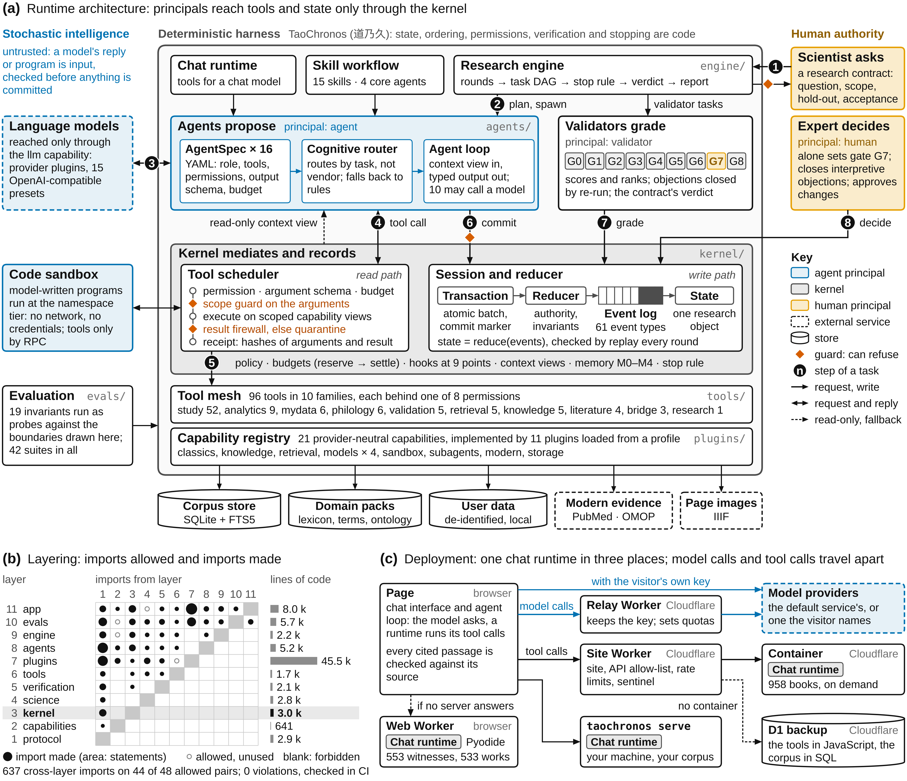

# The architecture in one figure



| File | What it is |
|---|---|
| [`architecture.pdf`](architecture.pdf) | the master: vector, 7.0 × 6.03 in, TrueType fonts only (embedded subsets), text live |
| [`architecture.png`](architecture.png) | the same page at 600 dpi (4200 × 3620 px, RGB), for slides, Word and the web |
| [`architecture.json`](architecture.json) | every number the figure draws, as read from the repository |
| [`architecture.py`](architecture.py) | reads the harness, writes the three files above and checks them |

It complements [architecture.md](../architecture.md), which says the same in words, and Fig. 1 of the paper
([paper/](../../paper/README.md)), which shows who may do what, agent by agent. This one shows the system: what stands
between a model and everything else.

## Legend

**TaoChronos (道乃久): a deterministic harness around stochastic intelligence.**
**a**, Runtime architecture. Who acts stands above the kernel, what is acted on below it, and nothing passes from one
to the other except through it. Agents — declarative specs that a router gives to rules, to a language model or to
both — only propose; validators grade; the expert alone sets gate G7; the scientist's research contract is fixed before
the first task. Blue marks what is not trusted: a model's replies, and the programs a model writes, which run in a
sandbox and reach tools only by RPC through the scheduler. The numbers follow one research task. ① The contract opens
a research. ② The engine plans a round and spawns its agents, each under an identity and a budget. ③ An agent may
consult a model. ④ Every tool call passes the scheduler: permission, argument schema, budget, the scope guard, the
call itself on capability views cut to the caller's scope, the result firewall, a receipt. ⑤ Tools reach stores and
services only through provider-neutral capabilities. ⑥ An agent's typed output is committed as one transaction, past
the commit guards (provenance, semantic support, anachronism). ⑦ Validators grade it: gates, scores, objections, the
contract's verdict. ⑧ The expert decides. Every write is an event, which the reducer accepts or refuses by the
principal of whoever emits it; the state is the reduction of the log, and is checked against a replay every round.
Diamonds are guards: deterministic checks that can refuse. The report leaves past the last of them, the publish guard.
**b**, The layering rule (`architecture-policy.yaml`: a row may import its marked columns) against the imports the
source makes. Discs, import statements, their area in proportion to their number; rings, pairs the rule allows and
nobody uses; blank, forbidden. Bars, lines of code. The kernel imports the protocol and nothing else.
`taochronos governance` checks the rule on every push.
**c**, Deployment of the conversational agent. The page runs the agent loop. Its model calls go to the relay, which
holds the key, or straight to a provider with the visitor's own. Its tool calls go to the chat runtime — the harness
of **a**, offered as tools — in one of three places: a container behind the site's Worker, a server on the user's own
machine, or a Web Worker in the page itself when no server answers. Without a container the site's Worker answers
from the D1 backup.

Counts are those of the repository when the figure was drawn (`architecture.json`). Paths in grey (`kernel/`,
`agents/` …) are the packages of `src/taochronos/`; the same names are the layers of **b**.

## What it follows

One view per panel, as architecture descriptions are written: the runtime view (**a**), the module view (**b**) and
the deployment view (**c**). Within them:

| Principle | Where the figure shows it | Where the code holds it |
|---|---|---|
| Complete mediation | **a**: every arrow from a principal ends at the kernel; steps ④ and ⑥–⑧ | `kernel/tools.py`, `kernel/session.py`, `kernel/reducer.py` |
| Least privilege | **a**: four principals, one permission per tool, scoped capability views | `kernel/authority.py`, `kernel/policy.py`, `verification/scope.py` |
| Untrusted input, isolated | **a**: the blue zone; the sandbox's single channel | `agents/runtime.py`, `plugins/sandbox/` |
| State as a log; replay | **a**: transaction → reducer → event log → state | `kernel/session.py`, `kernel/store.py` |
| Mechanism apart from policy | **a**: specs, router, capability registry, profile | `agents/*.yaml`, `profiles/*.yaml`, `kernel/registry.py` |
| Strict layering, a small core | **b** | `architecture-policy.yaml`, `governance.py` |
| Boundaries that are tested | **a**: Evaluation; **b**: the count of violations | `evals/boundaries.py`, `.github/workflows/ci.yml` |
| Degrading in steps | **c**: the two dotted paths | `web/js/runtime.js`, `cloud/site/src/backup/` |

And on the page:

- **One meaning per mark.** A box is code, a dashed box a service outside, a cylinder a store, a diamond a check that
  can refuse, a numbered disc a step. Solid arrows are requests and writes; dotted ones, read-only views and fallbacks.
- **One meaning per colour**, from the Okabe–Ito palette, as in the paper's figures: blue for what an agent or a model
  does, orange for what a human does, vermillion for what can refuse, grey for the kernel. Every coloured thing is
  also named, so the figure reads in greyscale and with any colour vision.
- **Names, not sentences.** A box holds a name and at most three short lines; the reasoning is in the legend.
- **Sized for print.** 7 in wide — the text width of a two-column ACM, IEEE or USENIX page — with text of 6–8 pt and
  strokes of 0.3–0.9 pt at that size, never scaled.
- **Counted, not typed.** Each number is read from the code that defines it, so a change in the code changes the
  figure at the next run.

## Drawing it again

```bash
pip install -e . matplotlib numpy pillow pymupdf
```

```bash
python docs/figures/architecture.py
```

`--draw-only` draws from the `architecture.json` already there; `--out DIR` writes the PDF and the PNG elsewhere. The
script prints what it measured and exits with 1 if anything is off: the page's width, a font that is not TrueType,
text under 6 pt, text that leaves the page or its box, text over text. The same source data gives the same bytes.

Arial is used where it is installed, Liberation Sans (the same metrics, so the same layout) where it is not; the files
here were drawn with Liberation Sans. In LaTeX:

```latex
\begin{figure*}[t]
  \centering\includegraphics[width=\textwidth]{architecture.pdf}
  \caption{TaoChronos: a deterministic harness around stochastic intelligence. \dots}
\end{figure*}
```
