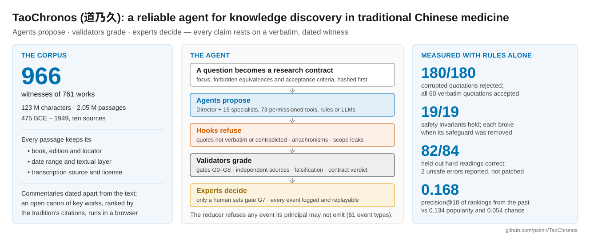

# Manuscript · TaoChronos: A Reliable Agent for Knowledge Discovery in Traditional Chinese Medicine



The paper on TaoChronos (道乃久), written for **npj Digital Medicine** (Article) with a condensed version for
**Engineering** (Research Article). It reuses the display-item package one directory up (`paper/figures`,
`paper/tables`, `paper/supplementary`): six figures, their legends and source data, the tables and the Supplementary
Information. Every number in the text comes from that package, from `taochronos eval` or from the documented
full-corpus runs in [`docs/evals.md`](../../docs/evals.md). No language model was called in any analysis.

| File | What it is |
|---|---|
| [`manuscript.md`](manuscript.md) | npj Digital Medicine Article: abstract (150 words), Introduction with the four contributions, Results, Discussion, Methods, statements |
| [`engineering.md`](engineering.md) · [`highlights.md`](highlights.md) | Engineering Research Article (numbered sections, American spelling, about 4,400 words with references, captions and Table 1, plus five figures), highlights, keywords |
| [`references.bib`](references.bib) | one bibliography (53 entries, each checked against an online record on 2026-10-18); `csl/` holds the Nature and Elsevier–Vancouver styles |
| [`tables/`](tables/) | Table 1 (new) and Table 2 as Markdown, LaTeX, CSV and Word (three-line tables), from `make_manuscript_tables.py` |
| [`figures/graphical_abstract.svg`](figures/graphical_abstract.svg) | graphical abstract (1328 × 531 px; PNG at twice that) — also usable in the repository's README |
| [`cover_letter_npj.md`](cover_letter_npj.md) · [`cover_letter_engineering.md`](cover_letter_engineering.md) | cover letters |
| [`submission/npj/`](submission/npj/) | built files: manuscript (Word, PDF, LaTeX, Markdown) and the Supplementary Information renumbered for npj |
| [`submission/engineering/`](submission/engineering/) | built files: manuscript, `Highlights.docx`, `Graphical_abstract.png`, Appendix A (Supplementary data) |
| [`build.py`](build.py) | rebuilds everything in `submission/` |

## The four contributions (Introduction)

1. **An agent architecture that separates proposal from verdict** — agents propose, validators grade, only a human
   expert approves; every claim verbatim and stated by its quote; nine gates; an executable research contract.
2. **A dated, layered and licence-tracked corpus** — 966 witnesses of 761 works, 123 M characters, 2.05 M passages,
   475 BCE–1949; an open canon defined by the tradition's citations that runs in the browser.
3. **A three-layer evaluation of reliability and research value** — invariants checked by mutation, hard interpretive
   cases with unsafe errors counted apart in blind rounds, and a blind temporal benchmark with leakage counted.
4. **Guarded translation to modern medicine and complete transparency** — phenotypic similarity through HPO, never
   retrospective diagnosis; a complete replayable research run released with its unrepaired failure analysis.

The Introduction presents ZhongJingGPT as the first large language model dedicated to TCM (Kang et al., *Tsinghua
Science and Technology*, doi:10.26599/TST.2025.9010046; first model trained in May 2023), and positions TaoChronos as
complementary to it: a domain model can be the proposer inside the harness.

## Table 1 — usable in the repository README as it stands

The full table, with its notes, is [`tables/table1.md`](tables/table1.md).

| Failure mode | Mechanism in TaoChronos | Evidence in this study |
|---|---|---|
| Fabricated or altered quotation | the harness, not the producer, locates every quote at commit; the chat client checks every cited passage | 180/180 corrupted quotations rejected, 60/60 verbatim accepted (Fig. 4a) |
| True quote, false reading | semantic-support hook reads speaker, stance, conditions and negations; crux registry | 82/84 held-out hard cases, 2 unsafe; four blind rounds (Fig. 4c,d) |
| Copies counted as independent testimony | G5 counts source families, not books | H5 held inconclusive on one family (Fig. 3e) |
| Anachronism | guard at claim, hypothesis and graph-write hooks; bridge states similarity only | statements 10/10, mappings 8/8, translations 24/24 |
| Arguments from silence | Skeptic searches the whole scope for explicit later or earlier statements | 4 wrong predictions rejected, no discovery (Fig. 5d) |
| Self-grading, premature acceptance | event authority by principal; only validators grade; only a human sets G7; executable contract | 19/19 invariants; each of 6 boundaries removed broke its own (Fig. 4b) |
| Hindsight in testing foresight | time-machine views bounded in SQL on every read path | leakage 0; precision@10 0.168 vs 0.134 vs 0.054 (Fig. 5) |
| Irreproducible runs | append-only log replayed and hashed; receipts in a hash chain | crash–resume, reruns and parallel runs identical |

## Display items in each journal

Neither journal has Extended Data, so the build renumbers the package's Extended Data items; Engineering counts
figures, tables and references in its ~6,000-word limit, so two more items move to its Supplementary data.

| Package (`paper/`) | npj Digital Medicine | Engineering |
|---|---|---|
| Figs. 1–5 | Figs. 1–5 | Figs. 1–5 |
| Fig. 6 (study layer) | Fig. 6 | Supplementary Fig. 5 |
| — (new) | Table 1 (failure modes) | Table 1 |
| Extended Data Table 2 (evaluation) | Table 2 | Supplementary Table 14 |
| Extended Data Table 1 (sources) | Supplementary Table 13 | Supplementary Table 13 |
| Extended Data Figs. 1–3 | Supplementary Figs. 2–4 | Supplementary Figs. 2–4 |
| Supplementary Fig. 1, Tables 1–12, Notes 1–4, Data 1–2 | unchanged | unchanged (Appendix A) |

## Journal requirements (checked 2026-10-18; confirm on the live pages before submitting)

| | npj Digital Medicine | Engineering |
|---|---|---|
| Length | no strict limit; abstract ≤ 150 words, unstructured | ~6,000 words including abstract, keywords, figures, tables and references |
| Title | ≤ 15 words; the guide asks for no punctuation (see below) | no limit found |
| Structure | Introduction (no subheadings), Results, Discussion (no subheadings, no separate limitations), Methods | numbered sections: Introduction, Materials and methods, Results, Discussion, Conclusions |
| References | Nature style, numbered; > 5 authors → first author et al. | numbered in square brackets, order of first citation |
| Also required | Data availability; author contributions; competing interests; declared LLM use; reporting summary encouraged | 3–5 keywords; highlights (3–5, ≤ 85 characters); graphical abstract; CRediT; generative-AI declaration |

Sources: <https://www.nature.com/npjdigitalmed/content-types>,
<https://www.nature.com/npjdigitalmed/for-authors-and-referees/submission-guidelines>,
<https://www.sciencedirect.com/journal/engineering/publish/guide-for-authors>,
<https://www.engineering.org.cn/engi/EN/guidelines>.

## Build

```bash
pip install -e . python-docx pyyaml pillow      # pandoc ≥ 3 and Chromium must be installed (Chromium for the PDFs)
python3 paper/manuscript/build.py               # both journals → paper/manuscript/submission/
python3 paper/manuscript/build.py npj           # or: engineering
```

Edit `manuscript.md`, `engineering.md`, `references.bib` or the tables' script, never the files in `submission/`. The
LaTeX output compiles with xelatex (xeCJK for the Chinese) and takes the vector figures from `paper/figures/out`.

## Before submission — decisions for the authors

1. **Authors, affiliations, contributions, funding and competing interests** are placeholders. If the authors or
   IMPF-AI are connected with ZhongJingGPT (the CMLM-ZhongJing project), declare it. "First TCM LLM" is attributed
   in the text to its authors ("introduced in 2023 as the first …"), which is how it is cited.
2. **Declare the use of AI assistance** in drafting, as both journals require (placeholders in Methods and in the
   Engineering declaration).
3. **Add a licence for the code.** The repository has no LICENSE file, and both Code availability statements need
   one; also tag the release used for the paper and fill in the tag.
4. **Title and npj's punctuation rule.** The title has a colon; npj's content-type page asks for titles of at most
   15 words without punctuation. If the editors insist: "A reliable agent for knowledge discovery in traditional
   Chinese medicine" (TaoChronos named in the abstract).
5. **Corpus.** Every figure, table and number built on the open canon corpus (Figs. 2e, 3 and 6, Supplementary
   Figs. 1 and 3, Supplementary Tables 9–12, Supplementary Data 1–2) was rebuilt on 2026-10-19 on the corpus as now
   distributed: 533 of the 535 ranked works, 553 witnesses, 10.46 M characters. `bash paper/make_all.sh` rebuilds
   them; if the corpus changes again, rerun it and update the numbers in both manuscripts and `paper/legends.md`.
6. **Fonts.** The figures were rendered with Arial and Noto Sans CJK SC (QC report: `paper/figures/out/qc`); render
   on a machine with both, or the figure script substitutes a fallback and the QC report says so.
7. **Full-corpus values** (Fig. 5, parts of Table 2) come from documented runs on a store that cannot be
   redistributed; offer reviewers access to the store or to the run outputs.
8. **References to confirm:** the volume and pages of the Virtual Lab paper (DOI is authoritative), and whether the
   arXiv-only items (AI co-scientist, PaperQA2, TCMBench, GujiBERT) have since been published.
9. **Strengthen before review if possible:** expert-annotated gold on the full corpus and an evaluation with a
   model in the loop are the two gaps reviewers are most likely to raise; both are stated as limitations.
10. The conversation records in `data/chat-logs/` were **not** used; using them would need consent for research use
    and ethics approval.

---

**中文说明（简要）**：本目录是论文《TaoChronos: A Reliable Agent for Knowledge Discovery in Traditional Chinese
Medicine》的投稿稿件。`manuscript.md` 面向 *npj Digital Medicine*（摘要 150 词，引言含四项贡献，并将 ZhongJingGPT
介绍为首个中医大语言模型），`engineering.md` 是面向 *Engineering* 的压缩版（约 6,000 词限额内）。运行
`python3 paper/manuscript/build.py` 生成 Word、PDF 和 LaTeX。投稿前请完成上面"Before submission"清单：作者与利益冲突、
AI 辅助声明、代码许可证、等。全部图表已于 2026-10-19 在当前完整开放语料（535 部要籍中的 533 部，553 个版本）上重建。
