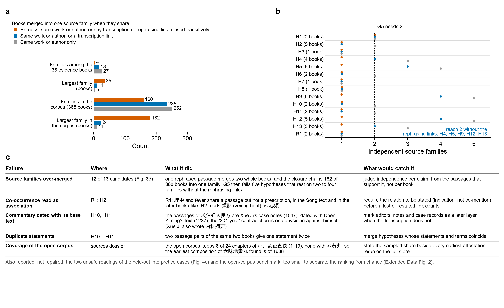
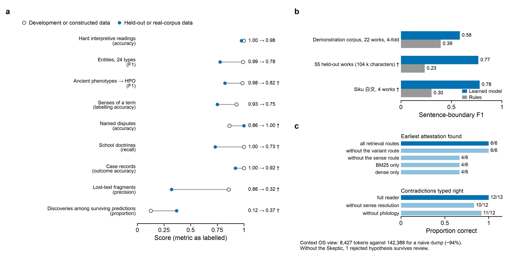
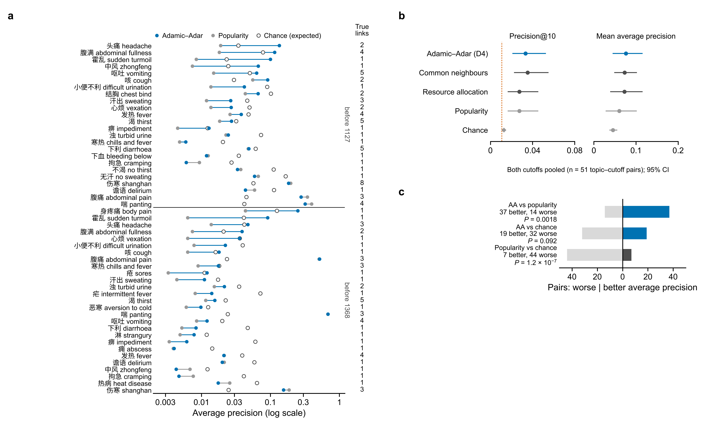
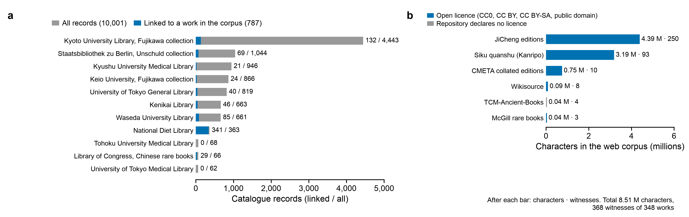
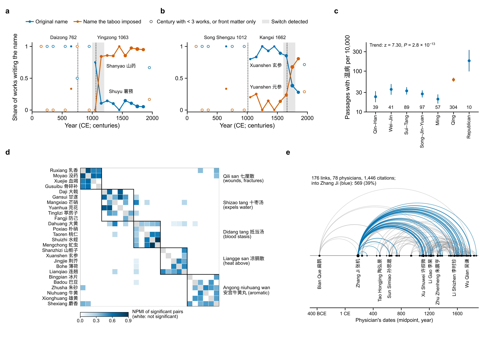

**TaoChronos (道乃久)**

Contents: Supplementary Notes 1–4; Supplementary Tables 1–12 (each also as CSV in `tables/`); Supplementary Fig. 1; Supplementary Data 1 (the Discovery Report of the end-to-end run) and 2 (its event log).

## Supplementary Note 1 | Evaluation design

TaoChronos-Eval has forty suites in three layers. The first tests the harness's boundaries: nineteen invariants run as probes against the harness under test, each checked by mutation (the boundary removed, the invariant broken, the boundary restored; Fig. 4b measures all nineteen on every variant). The second tests readings: 107 verbatim quotations that can still be read wrongly, in eight classes, with unsafe errors (those that would let a false claim through) counted apart. The split into 23 development and 84 held-out cases was fixed before the suite first ran, and four blind rounds were each written before the rules that first read them (Fig. 4d). The third tests research value: a blind temporal benchmark in which the store is split at a cutoff year, passages that may have been written on either side belong to neither side, the rules were written before the first run (evals/gold/research_value.yaml) and every read path is bounded in SQL, so that leakage is counted rather than assumed; graph rankings are compared with popularity, chance and two other link predictors, and the pipeline's own predictions are judged by later books.

The other suites measure each capability in the way its task allows: constructed data where an answer can be constructed (planted drug pairs, artificial manuscript traditions, a lost work quoted by four books), a development set where rules need examples, and results the literature already holds where the real corpus can be checked (the taboo renamings of Supplementary Fig. 5, the Yunqi chapters of the Suwen, the first gloss of 几几). Development and constructed sets were written with the rules they test; they are regression tests of intended behaviour, and only held-out or real-corpus results estimate generalization (Supplementary Fig. 2). The two held-out sets of the V2 layer (entities, ancient phenotypes) were annotated before the rules ran on them. Everything but the full-corpus suites reruns on the demonstration corpus in under a minute (`taochronos eval`); the full-corpus values, which need a store that is not distributed, are transcribed from docs/evals.md and marked. Supplementary Table 1 lists every suite.

**Supplementary Table 1 | The forty evaluation suites: question, data and split, metrics, result and where the paper reports them** (`tables/S1_evaluation_design.csv`)

| Layer | Suite | Question | Data and split | Metrics | Result | Reported in |
|---|---|---|---|---|---|---|
| Boundaries | invariants | Do the harness's boundaries hold — scope on every read path, semantic support at commit, objections a model cannot close, AfterToolCall denials, isolation of model code, atomic batches, G7 for experts only, evidence bounds, G8 by stance and level, read-only agent views, integrity, retraction, publication on current versions, acceptance ≠ execution? | 19 probes (the audit's counterexamples P01–P10 and nine boundaries added with them) run against the harness under test; six boundaries removed in turn (mutation) | held / exercised / broken | 19/19 held (P01–P10 and nine boundaries added with them); each of six boundaries removed on purpose (scope guard, result firewall, semantic support hook, reducer authority, evidence bounds, publish guard) breaks its invariant | Fig. 4b; Supplementary Table 14 |
| Readings | interpretive | Are true quotes read right where the reading is hard — inverted relations, a prohibition beside a prescription, consequences, reported and rejected views, omitted conditions, mixed witnesses, disputed dates, textual cruxes? | 107 verbatim cases in 8 classes (gold/interpretive.yaml); 23 development, 84 held-out, split fixed before the first run; 4 blind rounds | accuracy and unsafe errors, per class and per split (dev / held-out) | held-out 82/84 (0.976), 2 unsafe (大黄牡丹汤 read as an indication; 里水, a crux the harvest does not find); dev 23/23. First blind round 43/53 (0.811); round 3, before the crux registry, 7/10 with 3 unsafe cruxes; see below | Fig. 4c,d; Supplementary Table 14 |
| Research value | research_value | On the full corpus split at a cutoff year: do the graph rankings D4 uses anticipate the remedies later books link to a disease, better than popularity and chance?  Do the pipeline's own predictions, made on the past alone, come true? | full corpus split at 1127 and 1368: 230 topic–cutoff pairs read, 189 with a link that came true, 29,467 candidates; the pipeline run on the past view at 1368 for 2 development and 4 held-out topics; replicated on the open corpus (Supplementary Fig. 3) | hits and precision@k, mean average precision, paired sign tests over topics; predictions held (strict / loose), per split and review status; leakage | precision@10 0.168 (popularity 0.134; chance 0.054); average precision above popularity in 149 of 189 pairs (P = 2.4 × 10⁻¹⁶); held-out predictions: discoveries 7/19; open corpus: above popularity 24/6 (P = 0.0014), not separable from chance 13/17 (P = 0.58) | Fig. 5; Supplementary Fig. 3; Supplementary Table 14 |
| Verification | philology | Are contested readings kept with probabilities and an uncertain mass? Are variant spellings normalised for matching? | 7 contested readings (gold/philology.yaml) | pass rate | 7/7 | — |
| Verification | claims | Does extraction find the right hyperedges (relation + key arguments + negations)? | 42 gold hyperedges (gold/claims.yaml), development | precision · recall · F1 · recall by relation · provenance pass rate | P 1.0 · R 0.976 · F1 0.988 (miss: the second 湿痹 sign definition). Before the general PROGNOSIS rule (则愈 / 自愈 / 欲解 / 可治 … / 者死 / 难治 / 不治 …): P 0.976 · R 0.952 · F1 0.964, prognosis recall 0 — this gold is dev | Supplementary Table 14 |
| Verification | provenance | Are all committed claims and evidence verbatim? How deep is the Claim → Pixel chain? | every claim and evidence record a demonstration run commits | verbatim rates · chain depth · level availability | 100% verbatim claims and evidence; mean chain depth 7.8; page/line/region/image unavailable (no images in the demo) | Supplementary Table 14 |
| Verification | hallucination | Are fabricated, one-character-perturbed and mis-positioned quotes caught, without flagging real quotes or variant spellings? | 60 random passages × 4 probes: verbatim, one character replaced, random characters, shifted span | detection rates · verbatim recall | fabricated 100% · perturbed 100% · wrong span 100% detected; verbatim recall 100%; variant spelling accepted | Fig. 4a; Supplementary Table 14 |
| Verification | contradiction | Contradiction vs conditional vs apparent vs support vs unrelated (including differential diagnosis and transcription) | 12 passage pairs (gold/contradictions.yaml) | accuracy · macro-F1 · confusion | 12/12 | — |
| Verification | lineage | Formula derivation, citation, transcription, rephrasing, inheritance, opposition | typed links of the demonstration corpus (gold/lineage.yaml) | precision (judged) · recall · unjudged predictions | P 0.867 · R 0.929 — false positives 逍遥散 ← 苓桂术甘汤 and 补阳还五汤 ← 透脓散 (convergent compositions); miss: 王清任's implicit opposition | — |
| Verification | temporal | Period constraints, earliest attestations (through variant spellings and concepts that predate their names), period leakage | 6 period constraints, 6 earliest attestations (gold/temporal.yaml) | accuracies · leakage count | constraints 6/6 · earliest 6/6 · leakage 0 | Supplementary Table 14 |
| Verification | anachronism | Are equations of historical and modern concepts blocked, careful phrasings allowed, mappings typed conservatively, agent-asserted equivalence refused? | 10 statements, 8 mappings, agent-asserted equivalences (gold/anachronism.yaml) | statement accuracy · block P/R · mapping accuracy | statements 10/10 · mappings 8/8 · agent equivalence blocked | Supplementary Table 14 |
| Verification | recovery | After crashes at several points, does resume reach the identical scientific state? Are reruns and parallel runs identical? | crashes at 4 points of a run; reruns; parallel against sequential runs | success rate · replay consistency | 4/4 crash points; deterministic rerun; parallel = sequential; replay consistent | — |
| Research value | time_machine | Research on texts before a cutoff (a separate harness, nothing later indexed); are its structured predictions borne out by later texts? | the demonstration corpus split at 1368 (a separate harness indexes the past only) | decidable predictions · accuracy (survived vs other) · leakage · link-prediction baselines | a passage is on one side of the cutoff only when its whole date range is (straddling texts are in neither the past corpus nor the checking future; none at 1368); 3 decidable predictions, 2 held (taboo rename persisted; lost association stayed absent); failed: the 肾气丸-family core predicted from two members — 张景岳's 左/右归丸 dropped 泽泻·牡丹皮·茯苓 | — |
| Research value | source_rediscovery | Hold out a cited book: is it re-inferred as a missing source, dated before its earliest citer? | 3 cited books held out (gold/rediscovery.yaml) | recall@3 · date-bound consistency | 3/3 re-inferred with consistent date bounds | — |
| Verification | ablations | Which components carry the results? | demonstration corpus: 6 terms, 12 passage pairs, the agents' context, runs without the Skeptic | earliest accuracy without routes · contradiction accuracy without sense/philology · G5 inflation without clusters · Context-OS token reduction · false survivals without the Skeptic | earliest accuracy: all 1.0 · no sense route 0.67 · BM25 only 0.67; contradiction: no sense resolution 0.83 · no philology 0.92; 1 hypothesis would pass G5 only by counting dependent books; Context OS −94% tokens; without the Skeptic 1 rejected hypothesis survives and no revisions happen | Supplementary Fig. 2c |
| Deep discovery | collation | Are the variants of a known tradition found, and its stemma, groups and contamination recovered? | 5 artificial traditions copied from the demo corpus down a known stemma (two branches; one witness copied from both) | unit recall / precision · split recall · Robinson–Foulds · group precision · contamination P/R | variant units: recall 0.998 · precision 0.999; the true split recovered in every trial (RF 0.33: neighbour-joining resolves the true polytomy — three copies made independently from one exemplar — into an extra split); top-3 groups all genuine (all groups 0.73); contamination P 1.0 · R 1.0 | Supplementary Table 14 |
| Deep discovery | reuse | Is each reuse typed right (直接引用 … 套语相似), and are real reuses found? | 33 author-constructed pairs (gold/reuse.yaml), all eight types and unrelated pairs | accuracy · macro-F1 · mode accuracy · detection P/R/F1 · pipeline recall | accuracy 0.97 · macro-F1 0.965 · mode 0.97; detection P 1.0 · R 0.96 · F1 0.98; the demo corpus's gold transcriptions and rephrasings found by study.reuse: 1.0 | Supplementary Table 14 |
| Deep discovery | stratigraphy | Are the layers of composite texts found, with their boundaries, and are texts attributed to their authors? | 5 composites of 16 000 characters with blocks rewritten in a second author's function characters; the real 素问 and 伤寒论 | layer accuracy · change-point and boundary P/R · attribution accuracy · real checks (素问 运气七篇, 叔和 chapters) | layer accuracy 0.955; boundaries R 0.90 · P 0.93; change points R 0.45 · P 1.0; attribution 0.89 · real: the 运气七篇 7/7 in the minor layer, both of their boundaries found, 3 of the 4 chapters flagged by late vocabulary are 运气 chapters, 辨脉法 and 平脉法 nearest the 脉经 | Supplementary Table 14 |
| Deep discovery | cases | Are case records cut into cases and visits, and are their fields read right? | 6 constructed cases in the two manners of the literature — visits under a heading, narratives (gold/cases.yaml); the two transcriptions of 吴鞠通医案 | segmentation · per-field accuracy · response and outcome accuracy · agreement of two transcriptions | segmentation, fields, responses, outcomes 1.0 on the development set · real: case counts agree 0.98, outcomes 0.92 | — |
| Deep discovery | argument | Are the steps of reasoning found and typed? | 18 author-constructed passages (gold/argument.yaml); the 脉经's two transcriptions against 温病条辨 | labelled and unlabelled edge P/R/F1 · clause segmentation · same-work vs other-work divergence | edges F1 1.0 on the development set · real: JSD 0.020 between the transcriptions of one work, 0.091 against another | — |
| Deep discovery | senses | Is a planted shift of senses dated, and a sense no cue names found? | synthetic occurrences: one sense rises from 15 % to 75 % in the year 1000, an uncued sense appears from 1300 | change-year error · detection · labelling accuracy · hidden sense found · curated exemplars | change year within 2.3 years; detected 1.0; labelling 0.93; the uncued sense found 1.0 (precision 1.0); curated exemplars of 消渴 6/8 | — |
| Deep discovery | fragments | Is a lost text rebuilt from its quotations without taking in other sources' words? | a constructed lost work (集古方, held out) quoted by four books in the manners of the 外台秘要, the 医心方, the 证类本草 and a late paraphrase, beside other sources (gold/fragments/); the real 千金 and 肘后 | precision · coverage · decoy leaks · volume accuracy · real verification (千金, 肘后) | precision 0.86 · coverage 1.0 · no other source's words taken in · volumes 1.0 · real: 千金 precision 0.32 · coverage 0.12; 0.876 of the 肘后's quotations not in the extant text | Supplementary Fig. 2a; Supplementary Table 14 |
| Task specification | punctuation | Are the marks of 白文 placed where editors place them, with every character kept? | the store's punctuated texts; 55 works held out of training (104 k characters); 4 Siku 白文 works against their 笈成 punctuation | boundary / sentence F1 · mark-type accuracy · preservation rate · rule baseline · held-out works · Siku 白文 | held-out boundary F1 0.767 (P 0.725 · R 0.814; rules 0.235), typed sentence F1 0.543, mark types 0.805; 白文 boundary F1 0.780 (rules 0.303); characters preserved 1.0 | Supplementary Fig. 2b; Supplementary Table 14 |
| Task specification | commentaries | Are the commentaries on a clause found in every layout, attributed and compared? | a constructed classic with commentaries in four layouts (gold/commentaries/); the real 太阳之为病 | unit P/R/F1 · text F1 · relation F1 · quotation recall · real: known commentators and relations | units F1 1.0 · text F1 0.81 · relations F1 1.0 · quotations 1.0 · real: 25 commentaries, known commentators 11/11, 张卿子 照录 成无己 and 喻昌 承袭 方有执 found | — |
| Task specification | disputes | Are named views read as rejected or endorsed, and quoted words kept apart? | 22 author-constructed sentences (gold/disputes.yaml) | accuracy · reject / endorse P/R/F1 · real: known controversies | accuracy 0.86 · reject P 1.0 R 0.78 · endorse P 0.8 R 1.0 · real: 3/3 known controversies (景岳 on 丹溪's 相火, 越人's 左肾右命门 …) | — |
| Task specification | variant_impact | Is each variant reading classed by what it changes (dose, negation, drug, finding …)? | 30 readings (gold/variant_impact.yaml) | accuracy · macro-F1 · high-impact P/R/F1 · real: the review queue of the 伤寒论 | accuracy 0.97 · macro-F1 0.97 · high impact P 1.0 R 0.94 · real: the 伤寒论's 288 units, the top 10 of its review queue all high-impact | — |
| Task specification | clause | Are the parts of a clause (condition … prognosis) found? | 16 clauses of the 伤寒论 and 金匮 (gold/clause.yaml) | piece accuracy · macro-F1 · per-role F1 · segmentation · real: forms of the 伤寒论 | pieces 0.977 · macro-F1 0.92 · real: 40 % of the pieces of the fullest 伤寒论 witness read by no rule (平脉法 dialogues, numbering, notes) | — |
| Task specification | glosses | Are the glosses of a word found, and only of that word? | 16 sentences (gold/glosses.yaml) | accuracy · P/R/F1 · real: the first gloss of 几几 | accuracy 1.0 · P/R 1.0 · real: 成无己's 伸颈之貌 the first gloss of 几几 | — |
| Task specification | pairs | Do planted drug pairs come first, and do few chance pairs pass Benjamini–Hochberg? | 600 synthetic compositions with three planted pairs; the store's 66 196 compositions | planted top-3 · false significant · real: textbook pairs · 方证 links of 桂枝汤 and 麻黄汤 | planted top-3 1.0 · false significant 0.0 · real: 7/7 textbook pairs significant with lift > 1.5 (桂枝—芍药 2527 compositions, lift 2.05; 麻黄—杏仁 5.08 …) | Supplementary Fig. 5d; Supplementary Table 14 |
| Task specification | schools | Are a school's planted words found, and do the textbooks' doctrines come out as its own? | 5 synthetic 温病 physicians and 16 other authors; the store's schools with the textbooks' doctrines (gold/schools.yaml, 44) | planted top-2 and significant · common words listed · citation shares · real: doctrine recall and attribution | planted words top-2 and significant, no common word listed · real: doctrine recall 0.73 (z ≥ 1.96), attribution 0.64 | — |
| Task specification | names | Is the change of a drug's preferred name dated, and its names equated and completed? | 20 synthetic works (薯蓣 → 山药); the dated taboo renames (gold/names.yaml) | switch interval · nested names apart · equations · candidates · real: dated taboo renames | switch interval, nested names, equation, candidate 山芋 all right · real: 2/2 (薯蓣→山药 in 1000–1200, 玄参→元参 in 1600–1800) | Supplementary Fig. 5a,b |
| Task specification | chain | Does each witness of a passage hang from the witness it was copied from? | 6 artificial traditions of 12 witnesses; with each copy regularising spellings on its own | witnesses found · parent accuracy against the most-similar baseline, with and without convergent spellings | parent accuracy 1.0 (most-similar baseline 0.97); with convergent spellings 0.94 (baseline 0.87); witnesses found 0.96–1.0 | — |
| V2 | entities | Are the entities of a sentence found and typed (24 types)? | 41 dev sentences, 160 entities (gold/ner.yaml); 25 held-out sentences, 117 entities, annotated after the rules were written (gold/ner_heldout.yaml) | precision · recall · F1 | dev F1 0.991 · held-out F1 0.776 (P 0.783 · R 0.769) | Supplementary Fig. 2a; Supplementary Table 14 |
| V2 | places | Are physicians placed from their signatures, prefaces and biographies? | 15 signatures and 5 statements of native place in the forms of real prefaces and biographies, with traps (gold/places.yaml); the full corpus | precision · recall | P/R 1.0 · 84.6 % of physicians placed · real: 291 of 761 works placed, curated places confirmed 4/4, 湿温 in 清 江南 49 % vs 26 % (q 0.108, not significant) | — |
| V2 | translation | Does a translation keep the original layer and add no present-day diagnosis? | 24 presentism cases (equations, retrospective diagnoses, modern names a translation adds, comparisons that must pass); the demo corpus | guard accuracy · layer preserved | guard 24/24 · original layer unchanged 24/24 · doublets glossed by their commentators 3/3 | — |
| V2 | layout | Are page images read in order, with notes, margins and OCR errors located? | 60 synthetic pages (vertical, 双行小注, 版心, 书眉; noisy and character-level variants); four OCR formats; 12 OCR texts with one error each | reading-order accuracy · CER · notes F1 | reading order exact 0.983 · CER 0.0005 · notes F1 0.999 · formats identical · errors located 12/12 | — |
| V2 | bridge | Are the findings of a passage projected into HPO with typed relations? | 20 dev sentences; 12 held-out passages drawn at random from 65 clinical works of the full corpus, annotated before the reader ran on them; 18 canonical descriptions and 2 negatives (gold/bridge.yaml) | precision · recall · F1 | dev F1 0.985 · held-out P 0.938 · R 0.732 · F1 0.822, bounds 1.0 · mapping top-1 1.0, caps 3/3, guard 20/20 · 213 HPO ids valid in hp/releases/2026-09-01 | Supplementary Fig. 2a; Supplementary Table 14 |
| V2 | audit | Does each statement of an answer get the verdict its evidence supports? | 19 claims of every kind and 3 safety texts (gold/audit.yaml) | verdict accuracy · false SUPPORTED | verdicts 1.0 · kinds 1.0 · false SUPPORTED 0 · safety 3/3 | Supplementary Table 14 |
| V2 | modern | Are modern records typed by design and population, and cross-level claims refused? | 10 records to type, 7 claim/evidence pairs for the cross-level guard, the synthetic OMOP database (gold/modern.yaml) | typing accuracy · guard accuracy | typing 10/10 · guard 7/7 · RWD: SQL checks pass, planted association recovered, bad SQL refused | — |
| V2 | workflow | Does the orchestrator plan the skills a question needs and no others? | the registry; 8 questions with the skills they need and must not call (gold/workflow.yaml); one end-to-end run | valid plans · rerun from the workspace | registry valid · plans 8/8 · a rerun reads every step from its workspace | — |

## Supplementary Note 2 | Gates, permissions and authority

Five mechanisms bound what any part of the harness can do, and they are layered so that the failure of one is caught by another (Fig. 4b). (1) Permissions: every tool needs one permission, and an agent holds only those its specification lists (Supplementary Tables 4 and 5); an agent that asks for a tool outside them is refused and the refusal is logged. (2) Hooks: deterministic guards at eight points of the lifecycle (Supplementary Table 6) refuse a tool call or result outside the research's scope, a claim whose quote is not verbatim or contradicts it, an anachronistic equation and a report on unjudged versions. (3) Event authority: every change to the research object is an event, and the reducer refuses an event its principal may not emit; 61 event types, nine patterns of permission (Fig. 1b, Supplementary Table 7). An agent proposes; only validators grade, and only a human sets G7. (4) Gates G0–G8 grade each claim, evidence record and hypothesis on its current version (Supplementary Table 2). (5) The research contract, hashed before the first task, fixes the criteria by which a hypothesis is accepted, needs an expert, stays inconclusive or is rejected, and names the judge of each (Supplementary Table 3): finishing the tasks never accepts a research. In conversation, four core agents run the same specialists as fifteen skills (Supplementary Table 8).

**Supplementary Table 2 | Gates G0–G8: what each passes, warns and fails, and who sets it** (`tables/S2_gates.csv`)

| Gate | Name | Subject | Pass | Warn | Fail | Set by |
|---|---|---|---|---|---|---|
| G0 | Source | claim, evidence | the book is in the store with an origin and a licence (score 0.8 when the transcription is unverified) | — | unknown book, or no origin or licence | validator |
| G1 | Transcription | claim, evidence | a verified manual transcription, or OCR confidence ≥ 0.9 | an unverified transcription, or OCR confidence 0.7–0.9 | OCR confidence < 0.7 | validator |
| G2 | Philology | claim, evidence | text collated against an edition, and the span not on a contested reading | uncollated text, or a contested reading whose base reading has p ≥ 0.4 | the span rests on a contested reading with p < 0.4 | validator |
| G3 | Sense | claim; hypothesis | every term resolved to one sense for its period | a homonym whose most likely sense has p < 0.6 | — | validator |
| G4 | Claim provenance | claim, evidence; hypothesis | the quote is verbatim at its span and states the relation | verbatim, but the quote does not clearly state the relation, or states a view the author rejects | the quote is not verbatim or not where it is said to be, or it contradicts the claim | validator |
| G5 | Independent sources | hypothesis | supporting evidence from ≥ 2 independent source families (the contract may ask for more) | one family | no supporting evidence | validator |
| G6 | Falsification | hypothesis | the latest Skeptic review leaves no open critical or major objection | an open major objection | an open critical objection (pending before any review) | validator |
| G7 | Expert | hypothesis | a named expert approves | — | a named expert rejects (pending until then) | human only |
| G8 | Modern evidence | hypothesis (biomedical or bridge claims) | records in people support a biomedical claim; any modern record contextualizes a typed bridge | — | no modern record, or a record contradicts the claim; not applicable to historical hypotheses | validator |

**Supplementary Table 3 | The criteria of the research contract, each with its judge and the state it leaves when unmet** (`tables/S3_contract_criteria.csv`)

| Criterion | Requirement | Judge | State when unmet | H1 in Fig. 3 (observed) |
|---|---|---|---|---|
| min_supporting_evidence | ≥ 2 | validator:contract | inconclusive | pass: 2 verified supporting record(s) |
| semantic_support | every supporting claim borne by its quote | validator:contract | inconclusive | pass: every supporting claim is stated by its quote |
| source_dependence | ≥ 2 independent source families, on the current version | validator:contract | inconclusive | pass: G5 pass: 2 independent source cluster(s) (need 2): baoming_ji, jc_o128 |
| falsification_review | a skeptic review | validator:contract | inconclusive | pass: reviewed |
| unresolved_hard_objections | ≤ 0 | validator:contract | inconclusive | pass: 0 open hard objection(s) |
| unresolved_critical | ≤ 0 | validator:contract | inconclusive | pass: 0 open critical objection(s) |
| alternatives_addressed | every rival explanation of the discovery type excluded or stated as open | validator:contract | inconclusive | pass: all addressed; open: same_name_other_formula |
| current_version_gates | G0, G1, G2, G3, G4, G5, G6 on the current version (strict: G4, G5, G6) | validator:contract | inconclusive | pass: all required gates pass on this version |
| expert_review | an expert's approval | human | needs_expert | pending: G7 pending |
| falsification | not rejected | validator:contract | rejected | R1 in Fig. 3: status rejected |

**Supplementary Table 4 | The sixteen agents of a research: role, mode, minimum model tier, permissions, tools, output and budget** (`tables/S4_agents.csv`)

| Agent | Name | Role | Mode | Model tier (minimum) | Permissions | Tools | Output | Budget (tool calls · model calls) |
|---|---|---|---|---|---|---|---|---|
| curator | TaoChronos-Curator | Corpus Curator. Freezes scope, hold-out and coverage into the corpus manifest. | procedure | small | classics:read | classics.list_books, vision.layout, vision.compare | CorpusManifest | 10 · 0 |
| director | TaoChronos | Research Director. Plans each round and decides which specialists to spawn; never judges evidence alone. | hybrid | frontier | classics:read, kg:read, analysis:run, codemode:exec | classics.list_books, classics.search, kg.claims, analysis.temporal_profile | ResearchPlan | 30 · 6 |
| evidence | TaoChronos-Evidence | Evidence Retriever. The Evidence Ledger — verbatim, locatable, independently sourced. | hybrid | medium | classics:read, kg:read | classics.search, classics.get_passage, kg.claims, validation.verify_quote, study.cases, study.trajectories, study.argument, graph.evidence | EvidenceSet | 80 · 10 |
| evolution | TaoChronos-Evolution | Evolution Analyst. Concept timelines and formula family trees. | procedure | small | analysis:run | analysis.concept_drift, analysis.formula_evolution, analysis.temporal_profile | AnalysisSet | 20 · 0 |
| extractor | TaoChronos-Extractor | Claim Extractor. Passages to claim hyperedges with verbatim spans. | hybrid | medium | classics:read, kg:read | kg.extract_claims, kg.term, classics.get_passage, validation.verify_quote, study.clause, study.entities | ClaimSet | 80 · 10 |
| hypothesis | TaoChronos-Hypothesis | Hypothesis Generator. Observations to testable, evidence-bound hypotheses; revisions after review. | hybrid | frontier | classics:read, kg:read, codemode:exec | kg.claims, kg.neighbors, kg.term, classics.search, classics.get_passage, validation.verify_quote | HypothesisSet | 60 · 10 |
| lineage | TaoChronos-Lineage | Lineage Analyst. Citation, transcription, rephrasing, formula derivation and opposition edges. | procedure | small | classics:read, analysis:run | classics.lineage, philology.collate, analysis.missing_sources, study.schools, study.chain, study.places | LineageReport | 20 · 0 |
| meta_reviewer | TaoChronos-MetaReviewer | Meta-Reviewer. Systemic weaknesses, duplicates and next-round recommendations. | hybrid | frontier | kg:read, classics:read | kg.claims, audit.claim | MetaReview | 10 · 4 |
| modern_evidence | TaoChronos-ModernEvidence | Modern Evidence Analyst. The only door between the historical and biomedical spaces (Gate G8). | hybrid | frontier | literature:read, kg:read, classics:read | literature.modern_evidence, kg.term, bridge.map, bridge.reverse, modern.search, modern.safety, rwd.ask | ModernEvidenceSet | 30 · 6 |
| ontologist | TaoChronos-Ontologist | Ontologist / Terminology Curator. Typed historical-to-modern mappings, proposed only. | hybrid | frontier | kg:read, kg:propose, classics:read | kg.term, kg.propose_change, bridge.phenotype, bridge.map, bridge.reverse | MappingProposals | 40 · 6 |
| pattern_miner | TaoChronos-PatternMiner | Pattern Miner. Tool-first discovery engines D1–D5 and source rediscovery; no model. | procedure | small | analysis:run, kg:read, classics:read | analysis.*, study.pairs, study.network | ObservationSet | 60 · 0 |
| philologist | TaoChronos-Philologist | Philologist (校勘). Readings, variants, collation status — never a forced single reading. | hybrid | medium | classics:read | philology.*, classics.get_passage, validation.verify_quote, study.variants, study.stemma, study.layers, study.dating, study.authorship, study.witnesses, study.punctuate, study.commentaries, study.glosses, study.clause, study.entities, study.translate, vision.layout, vision.compare | PhilologyReport | 60 · 8 |
| scholar | TaoChronos-Scholar | Source Scholar (治学). The textual history of the focus formulas, drugs and terms over the whole corpus. | procedure | small | classics:read | study.formula, study.herb, study.term, study.senses, study.concordance, study.taboo, study.metrology, study.commentaries, study.disputes, study.network, study.schools, study.names, study.places, study.translate | SourcesDossier | 24 · 0 |
| semanticist | TaoChronos-Semanticist | Historical Semanticist. Period-bound sense resolution; guards against homonymy. | hybrid | medium | classics:read, kg:read | kg.term, classics.get_passage, classics.search, study.term, study.senses, study.glosses, study.names, study.entities, study.translate, bridge.phenotype | TermResolutionReport | 60 · 8 |
| skeptic | TaoChronos-Skeptic | Skeptic (falsification). Tries to break every hypothesis before anyone believes it. | hybrid | frontier | classics:read, kg:read, analysis:run, codemode:exec | classics.search, classics.get_passage, classics.lineage, kg.claims, philology.assess_passage, validation.verify_quote, analysis.temporal_profile, study.reuse, study.dating, study.argument, study.disputes, audit.claim, graph.evidence | ReviewSet | 400 · 12 |
| statistician | TaoChronos-Statistician | Statistician. Significance, multiple-testing control and coverage for every observation; no model. | procedure | small | analysis:run | analysis.link_prediction, analysis.temporal_profile | AnalysisSet | 20 · 0 |

**Supplementary Table 5 | The tool mesh: families, the permission each needs and the tools** (`tables/S5_tools.csv`)

| Family | Permission needed | What the permission allows | Tools | Names |
|---|---|---|---|---|
| analytics | analysis:run | run the discovery and statistics engines | 9 | analysis.association_rules, analysis.communities, analysis.concept_drift, analysis.contradictions, analysis.formula_evolution, analysis.link_prediction, analysis.lost_knowledge, analysis.missing_sources, analysis.temporal_profile |
| bridge | classics:read | read the corpus through the research's scoped view | 3 | bridge.map, bridge.phenotype, bridge.reverse |
| knowledge | kg:propose | propose a change to canonical knowledge | 1 | kg.propose_change (writes) |
| knowledge | kg:read | read the knowledge graph | 4 | kg.claims, kg.extract_claims, kg.neighbors, kg.term |
| literature | literature:read | read modern literature and real-world data | 4 | literature.modern_evidence, modern.safety, modern.search, rwd.ask |
| philology | classics:read | read the corpus through the research's scoped view | 6 | philology.assess_passage, philology.collate, philology.inspect_page, philology.normalize, vision.compare, vision.layout |
| research | codemode:exec | run code in the sandbox | 1 | research.run_code |
| retrieval | classics:read | read the corpus through the research's scoped view | 5 | classics.canon, classics.get_passage, classics.lineage, classics.list_books, classics.search |
| study | classics:read | read the corpus through the research's scoped view | 35 | study.argument, study.authorship, study.cards, study.cases, study.chain, study.citations, study.clause, study.commentaries, study.concordance, study.dating, study.disputes, study.entities, study.formula, study.fragments, study.glosses, study.herb, study.layers, study.metrology, study.names, study.network, study.pairs, study.places, study.punctuate, study.reading, study.reuse, study.schools, study.senses, study.stemma, study.taboo, study.term, study.trajectories, study.translate, study.transmission, study.variants, study.witnesses |
| validation | classics:read | read the corpus through the research's scoped view | 4 | audit.claim, graph.evidence, validation.provenance_chain, validation.verify_quote |
| validation | validation:run | run the gates (validators) | 1 | validation.gates |

**Supplementary Table 6 | The hooks the harness runs and what each refuses** (`tables/S6_hooks.csv`)

| Hook point | Guard | Runs on | Refuses |
|---|---|---|---|
| BeforeToolCall | scope_guard | every tool call | arguments that name material outside the research's scope (withheld books, the future of a blind cutoff) |
| AfterToolCall | scope_firewall | every tool result | a result that carries withheld material back to the caller |
| BeforeClaimCommit | provenance_validator | every claim | a quote that is not verbatim, empty or outside its passage; inconsistent argument spans |
| BeforeClaimCommit | semantic_support | every claim | a claim its quote contradicts (a true quote with a false relation); frames the rest with speaker, stance, conditions and negations |
| BeforeClaimCommit | anachronism_guard | every claim | a classical claim that carries a modern concept |
| AfterHypothesis | anachronism_guard | every hypothesis and revision | a statement that equates a historical concept with a modern category, or breaks a forbidden assumption of the contract |
| BeforeGraphWrite | anachronism_guard | every mapping into the knowledge graph | a historical-to-modern equivalence asserted by anyone but a human expert |
| BeforeArtifactPublish | publish_guard | every report that is not a draft | a report without evidence, one that cites missing or retracted objects, or one that presents a hypothesis not judged on its current version |

**Supplementary Table 7 | Event authority: the principals allowed to emit each event type (● allowed), with the reason where the table records one** (`tables/S7_event_authority.csv`)

| Event | Agent | Validator | Human | Kernel | Why |
|---|---|---|---|---|---|
| ResearchCreated |  |  |  | ● | only the harness opens a research contract |
| ProfileLoaded |  |  |  | ● |  |
| CorpusScoped | ● | ● |  | ● |  |
| RoundStarted |  |  |  | ● |  |
| RoundCompleted |  |  |  | ● |  |
| StopConditionMet |  |  |  | ● |  |
| ResearchCompleted |  |  |  | ● | only the harness completes a research |
| ResearchStopped |  |  | ● | ● |  |
| ContractEvaluated |  | ● |  | ● | the research contract is evaluated by validators |
| TaskPlanned | ● | ● |  | ● |  |
| TaskStarted | ● | ● |  | ● |  |
| TaskCompleted | ● | ● |  | ● |  |
| TaskFailed | ● | ● |  | ● |  |
| TaskSkipped | ● | ● |  | ● |  |
| AgentSpawned |  |  |  | ● |  |
| AgentReleased |  |  |  | ● |  |
| ModelRouted |  |  |  | ● |  |
| LLMCalled | ● |  |  | ● |  |
| ToolCalled | ● | ● | ● | ● |  |
| ToolResult | ● | ● | ● | ● |  |
| ToolDenied | ● | ● | ● | ● |  |
| HookBlocked | ● | ● | ● | ● |  |
| BudgetExceeded | ● | ● | ● | ● |  |
| BudgetReserved |  |  |  | ● |  |
| BudgetSettled |  |  |  | ● |  |
| RunManifestRecorded |  |  |  | ● |  |
| PassageAssessed | ● | ● |  | ● |  |
| TermResolved | ● | ● |  | ● |  |
| EvidenceRetrieved | ● | ● |  | ● |  |
| EvidenceRetracted |  | ● | ● | ● |  |
| ClaimExtracted | ● | ● |  | ● |  |
| ClaimRejected | ● | ● |  | ● |  |
| LineageDetected | ● | ● |  | ● |  |
| ContradictionFound | ● | ● |  | ● |  |
| ObservationRecorded | ● | ● |  | ● |  |
| AnalysisRecorded | ● | ● |  | ● |  |
| WarrantRecorded | ● | ● |  | ● |  |
| HypothesisGenerated | ● | ● |  | ● |  |
| CounterEvidenceFound | ● | ● |  | ● |  |
| HypothesisReviewed | ● | ● |  | ● |  |
| HypothesisRevised | ● | ● |  | ● |  |
| HypothesisRejected |  | ● | ● | ● |  |
| HypothesisScored |  | ● |  | ● | scores are computed by validators |
| HypothesisRanked |  | ● |  | ● | rankings are computed by validators |
| HypothesisConfirmed |  | ● |  | ● | confirmation is a validator's re-test on withheld material |
| GateEvaluated |  | ● |  | ● | gates are graded by validators, never by the work they grade |
| ObjectionResolutionProposed | ● | ● |  | ● |  |
| ObjectionClosed |  | ● | ● |  | an objection is closed by re-running its check (validator) or by an expert, never by a model |
| ChangeProposed | ● | ● | ● | ● |  |
| ChangeApproved |  | ● | ● |  | agents may only propose changes; a validator or human must decide |
| ChangeRejected |  | ● | ● |  | agents may only propose changes; a validator or human must decide |
| ExpertApproved |  |  | ● |  | only a human expert may approve or reject a hypothesis (Gate G7) |
| ExpertRejected |  |  | ● |  | only a human expert may approve or reject a hypothesis (Gate G7) |
| ExpertSteered |  |  | ● |  | only a human expert steers a research |
| DecisionRecorded | ● | ● | ● | ● |  |
| MemoryWritten |  | ● | ● | ● |  |
| BranchForked |  |  |  | ● |  |
| BranchMerged |  |  |  | ● |  |
| CheckpointCreated |  |  |  | ● |  |
| ArtifactPublished |  | ● |  | ● | publication is a validator's act after the contract is evaluated |
| TransactionCommitted |  |  |  | ● |  |

**Supplementary Table 8 | In conversation: the four core agents, the skills S01–S15 they run and the specialists they delegate to** (`tables/S8_core_agents_skills.csv`)

| Core agent | Skills | Specialists it delegates to | Permissions | Rules |
|---|---|---|---|---|
| 古籍学者 Classical TCM Scholar | S01 来源与版本 Source & Provenance; S02 影像与版面 Document Vision; S03 句读·训诂 Philology; S04 条文结构 Structure & Clause; S05 校勘 Collation; S06 互文与传承 Intertext; S07 知识抽取 Knowledge Extraction; S08 名称规范 TCM Normalization; S09 源流演变 Historical Evolution | curator, philologist, extractor, semanticist, lineage, scholar, evolution | classics:read, kg:read | the original is never changed; every reading is a layer with its source / absence is only meaningful where the period's coverage is adequate |
| 证据与批评 Evidence & Critic Agent | S15 证据审计 Evidence Audit | evidence, skeptic, statistician | classics:read, kg:read, literature:read, validation:run | a verdict is never raised by a model / SUPPORTED means the checks this system can run pass, not that the claim is true |
| 研究编排者 Research Orchestrator | plan plan; synthesize synthesize | director, meta_reviewer | classics:read, kg:read, analysis:run | rules plan first; a model may add or drop optional skills, never S01 or S15, and never a skill the registry lacks / the answer says what the evidence says and no more; the critic's verdict is shown beside each statement |
| 古今转译 Translational Medicine Agent | S10 古代表型化 Ancient Phenotyping; S11 本体桥接 Ontology Bridge; S12 古今映射 Clinical Mapping; S13 现代证据 Modern Evidence; S14 真实世界验证 RWD Validation | ontologist, modern_evidence, hypothesis | classics:read, kg:read, literature:read | phenotypic similarity, never retrospective diagnosis; no ancient name is equated with a modern disease / animal, cell and computational work is not efficacy in people; no clinical or dosage advice |

## Supplementary Note 3 | The end-to-end research case

The question 肾气丸的组成与主治如何随时代演变？ was put to the harness on the open canon corpus with `taochronos research "肾气丸的组成与主治如何随时代演变？" --profile web-canon --focus 肾气丸,六味地黄丸 --forbid 消渴=糖尿病`, offline: the rules ran alone and no model was called. The run scoped 206 books and 1,399 passages, planned 30 tasks in three rounds, called 156 tools (none refused), extracted 777 claims, recorded 87 evidence and 22 counter-evidence records and 24 hypotheses, and stopped after round 2, the last the contract allowed, when new evidence had fallen to 4.6%, below the 5% of its stop rule. It is deterministic: a second run writes the same report. The contract's verdict: one hypothesis (H1) meets every criterion a machine can check and waits for an expert, twelve are inconclusive and one (R1) is rejected. Supplementary Data 1 is the whole Discovery Report the run wrote, in Chinese, as a user of the harness receives it; Supplementary Data 2 is its event log, from which the state replays; Supplementary Tables 9 and 10 list every hypothesis and objection. Reading each surviving hypothesis against its evidence found five failure modes (Supplementary Fig. 1), the largest being that the independence check merged 35 of the 38 books that supplied evidence into one source family.

**Supplementary Table 9 | Every hypothesis of the end-to-end run (Fig. 3), with its gates, unmet criteria, objections and testable prediction** (`tables/S9_e2e_hypotheses.csv`)

| Label | Id | Kind | Generation | Parent | Status | Verdict | Gates G0–G8 | Criteria unmet | Objections (closed) | Statement | Testable prediction |
|---|---|---|---|---|---|---|---|---|---|---|---|
| H1 | hyp_d1436acd2959 | association_rule | 0 |  | survived | needs_expert | G0:pass G1:warn G2:warn G3:pass G4:pass G5:pass G6:pass G7:pending G8:not_applicable | expert_review | 0 (0) | 在主治类记载中，烦躁 并见时多用 六味地黄丸（置信度 1.0，lift 5.1053）：该组合可视为 六味地黄丸 的特征性指征。 | 在独立的后世方书中统计该症状组合的用方分布。 |
| H2 | hyp_12a32285d3a3 | lost_knowledge | 1 | hyp_71c99bcff38f | survived | inconclusive | G0:pass G1:warn G2:warn G3:pass G4:pass G5:warn G6:pass G7:pending G8:not_applicable | source_dependence, current_version_gates, expert_review | 6 (6) | 在本次调查的语料范围内，「肾气丸」与「心烦」的关联见于 960 年以前的《新编金匮方论（邓珍本）》、《金匮要略方（吴迁本）》、《脉经》、《脉经》、《新编金匮要略方论》，但此后的文献不再出现该关联，而两个概念本身仍在使用：这可能是一条在后世失传或被取代的知识（现有证据可能出自同一传本系统；目前仅有单一独立来源，需更多文献复核；探索性发现，未通过多重检验校正）。 | 扩大 960 年以后的文献样本（含其他版本与类书）：若该关联普遍存在则假说不成立；若只见于转引前代的文本则支持失传。 |
| H3 | hyp_e2ebd991ae10 | lost_source | 0 |  | survived | inconclusive | G0:pass G1:warn G2:warn G3:pass G4:pass G5:warn G6:pass G7:pending G8:not_applicable | source_dependence, current_version_gates, expert_review | 2 (0) | 语料未收之书《下經》曾经流传，并被 2 处文本直接引用，其成书早于约 1777 年；若确已亡佚，现存引文可作为辑佚线索（须先核查书目是否存世）。 | 在语料之外的唐宋类书与方书中检索《下經》的引文，比对文字异同。 |
| H4 | hyp_24368056df5c | concept_drift | 1 | hyp_53c77f1a68e3 | survived | inconclusive | G0:pass G1:warn G2:warn G3:warn G4:pass G5:warn G6:pass G7:pending G8:not_applicable | source_dependence, current_version_gates, expert_review | 8 (8) | 在本次调查的语料范围内，「中风」的主导含义在宋金元至明间发生转变：由「证名：外感风邪之表证（太阳中风）」转为「病名：卒中（半身不遂、口眼歪斜）」（语境差异 JSD=0.855）；不同时代文本中的「中风」不能按同一概念直接比较（现有证据可能出自同一传本系统；目前仅有单一独立来源，需更多文献复核；探索性发现，未通过多重检验校正）。 | 在更多同期文献中复核义项分布；按文献类型分层后差异仍存在，则支持概念演变。 |
| H5 | hyp_3849a6721ca0 | concept_drift | 1 | hyp_1ebef0b387ae | survived | inconclusive | G0:pass G1:warn G2:warn G3:warn G4:pass G5:warn G6:pass G7:pending G8:not_applicable | source_dependence, current_version_gates, expert_review | 8 (8) | 在本次调查的语料范围内，「中风」的主导含义在明至清间发生转变：由「病因：外感风邪」转为「病名：卒中（半身不遂、口眼歪斜）」（语境差异 JSD=1.0）；不同时代文本中的「中风」不能按同一概念直接比较（现有证据可能出自同一传本系统；目前仅有单一独立来源，需更多文献复核；探索性发现，未通过多重检验校正）。 | 在更多同期文献中复核义项分布；按文献类型分层后差异仍存在，则支持概念演变。 |
| H6 | hyp_de35c2a355f0 | lost_knowledge | 1 | hyp_44172aa26142 | survived | inconclusive | G0:pass G1:warn G2:warn G3:pass G4:pass G5:warn G6:pass G7:pending G8:not_applicable | source_dependence, current_version_gates, expert_review | 10 (10) | 在本次调查的语料范围内，「肾气丸」与「腹痛」的关联见于 960 年以前的《金匮要略方（吴迁本）》、《脉经》，但此后的文献不再出现该关联，而两个概念本身仍在使用：这可能是一条在后世失传或被取代的知识（现有证据可能出自同一传本系统；目前仅有单一独立来源，需更多文献复核；探索性发现，未通过多重检验校正；后世仍以相近表述出现，失传结论仅限于原表述；后世文本中仍有二者共现，但不再形成明确的主治记载）。 | 扩大 960 年以后的文献样本（含其他版本与类书）：若该关联普遍存在则假说不成立；若只见于转引前代的文本则支持失传。 |
| H7 | hyp_0af4af4a83db | association_rule | 1 | hyp_dc14fa336232 | survived | inconclusive | G0:pass G1:warn G2:warn G3:warn G4:pass G5:warn G6:pass G7:pending G8:not_applicable | semantic_support, source_dependence, current_version_gates, expert_review | 2 (2) | 在本次调查的语料范围内，在主治类记载中，壮热 并见时多用 六味地黄丸（置信度 1.0，lift 5.1053）：该组合可视为 六味地黄丸 的特征性指征（目前仅有单一独立来源，需更多文献复核）。 | 在独立的后世方书中统计该症状组合的用方分布。 |
| H8 | hyp_5730b22d8213 | lost_source | 0 |  | survived | inconclusive | G0:pass G1:warn G2:warn G3:pass G4:pass G5:warn G6:pass G7:pending G8:not_applicable | min_supporting_evidence, source_dependence, current_version_gates, expert_review | 2 (0) | 佚书《集验方》曾经流传，并被 1 处文本直接引用，其成书早于约 752 年；现存引文可作为辑佚线索。 | 在语料之外的唐宋类书与方书中检索《集验方》的引文，比对文字异同。 |
| H9 | hyp_ed4b5625f057 | concept_drift | 1 | hyp_32bbf0aeb230 | survived | inconclusive | G0:pass G1:warn G2:warn G3:warn G4:pass G5:warn G6:pass G7:pending G8:not_applicable | semantic_support, source_dependence, current_version_gates, expert_review | 10 (10) | 在本次调查的语料范围内，「伤寒」的主导含义在先秦两汉至宋金元间发生转变：由「证名：太阳伤寒（恶寒、体痛、脉阴阳俱紧）」转为「病类：一切外感热病的总称（广义伤寒）」（语境差异 JSD=1.0）；不同时代文本中的「伤寒」不能按同一概念直接比较（此处「伤寒」取「证名：太阳伤寒（恶寒、体痛、脉阴阳俱紧）」义；现有证据可能出自同一传本系统；目前仅有单一独立来源，需更多文献复核；探索性发现，未通过多重检验校正）。 | 在更多同期文献中复核义项分布；按文献类型分层后差异仍存在，则支持概念演变。 |
| H10 | hyp_502e05814d54 | contradiction | 1 | hyp_539ab225761b | survived | inconclusive | G0:pass G1:warn G2:warn G3:warn G4:pass G5:warn G6:pass G7:pending G8:not_applicable | semantic_support, source_dependence, current_version_gates, expert_review | 8 (4) | 《内科摘要》与《校注妇人良方》关于「痰」的论述存在实质性理论分歧（时代不同：相隔约 301 年），反映了学术范式的变化（此处「痰」取「病理：痰饮（水饮停聚）」义；现有证据可能出自同一传本系统）。 | 查找后出文本是否明确反驳前说（如“非……也”），并考察两说在各自学派中的承续。 |
| H11 | hyp_18f4717f2182 | contradiction | 1 | hyp_01f85940a40d | survived | inconclusive | G0:pass G1:warn G2:warn G3:warn G4:pass G5:warn G6:pass G7:pending G8:not_applicable | semantic_support, source_dependence, current_version_gates, expert_review | 8 (4) | 《内科摘要》与《校注妇人良方》关于「痰」的论述存在实质性理论分歧（时代不同：相隔约 301 年），反映了学术范式的变化（此处「痰」取「病理：痰饮（水饮停聚）」义；现有证据可能出自同一传本系统）。 | 查找后出文本是否明确反驳前说（如“非……也”），并考察两说在各自学派中的承续。 |
| H12 | hyp_80883924c519 | hidden_association | 1 | hyp_412994ed6551 | survived | inconclusive | G0:pass G1:warn G2:warn G3:warn G4:pass G5:warn G6:pass G7:pending G8:not_applicable | source_dependence, current_version_gates, expert_review | 6 (6) | 在本次调查的语料范围内，「呕吐」与「六味地黄丸」没有直接记载的联系，但经由 腰痛、妇人、下法 在知识超图中紧密相连：六味地黄丸 或可用于 呕吐（纯计算推断，需文献验证）（现有证据可能出自同一传本系统；目前仅有单一独立来源，需更多文献复核；二者在文本中已有共现，属未被结构化的关联，而非完全隐性）。 | 检索语料之外的方书与医案；若出现二者的直接关联，则为时间外推验证（Historical Time Machine）的正例。 |
| H13 | hyp_7c62e0a0d161 | hidden_association | 1 | hyp_8bec39add14d | survived | inconclusive | G0:pass G1:warn G2:warn G3:warn G4:pass G5:warn G6:pass G7:pending G8:not_applicable | semantic_support, source_dependence, current_version_gates, expert_review | 6 (6) | 在本次调查的语料范围内，「痰饮」与「六味地黄丸」没有直接记载的联系，但经由 短气、中焦、寒 在知识超图中紧密相连：六味地黄丸 或可用于 痰饮（纯计算推断，需文献验证）（现有证据可能出自同一传本系统；目前仅有单一独立来源，需更多文献复核；二者在文本中已有共现，属未被结构化的关联，而非完全隐性）。 | 检索语料之外的方书与医案；若出现二者的直接关联，则为时间外推验证（Historical Time Machine）的正例。 |
| R1 | hyp_ccbe3e9607db | lost_knowledge | 0 |  | rejected | rejected | G0:pass G1:warn G2:warn G3:pass G4:pass G5:warn G6:fail G7:pending G8:not_applicable |  | 5 (0) | 「理中丸」与「发热」的关联见于 960 年以前的《伤寒论（宋本·台北故宫）》、《伤寒论（宋本·安政本）》，但此后的文献不再出现该关联，而两个概念本身仍在使用：这可能是一条在后世失传或被取代的知识。 | 扩大 960 年以后的文献样本（含其他版本与类书）：若该关联普遍存在则假说不成立；若只见于转引前代的文本则支持失传。 |
| (superseded) | hyp_01f85940a40d | contradiction | 0 |  | superseded |  | G0:· G1:· G2:· G3:· G4:· G5:· G6:· G7:pending G8:· |  | 4 (0) | 《内科摘要》与《校注妇人良方》关于「痰」的论述存在实质性理论分歧（时代不同：相隔约 301 年），反映了学术范式的变化。 |  |
| (superseded) | hyp_1ebef0b387ae | concept_drift | 0 |  | superseded |  | G0:· G1:· G2:· G3:· G4:· G5:· G6:· G7:pending G8:· |  | 4 (0) | 「中风」的主导含义在明至清间发生转变：由「病因：外感风邪」转为「病名：卒中（半身不遂、口眼歪斜）」（语境差异 JSD=1.0）；不同时代文本中的「中风」不能按同一概念直接比较。 |  |
| (superseded) | hyp_32bbf0aeb230 | concept_drift | 0 |  | superseded |  | G0:· G1:· G2:· G3:· G4:· G5:· G6:· G7:pending G8:· |  | 5 (0) | 「伤寒」的主导含义在先秦两汉至宋金元间发生转变：由「证名：太阳伤寒（恶寒、体痛、脉阴阳俱紧）」转为「病类：一切外感热病的总称（广义伤寒）」（语境差异 JSD=1.0）；不同时代文本中的「伤寒」不能按同一概念直接比较。 |  |
| (superseded) | hyp_412994ed6551 | hidden_association | 0 |  | superseded |  | G0:· G1:· G2:· G3:· G4:· G5:· G6:· G7:pending G8:· |  | 3 (0) | 「呕吐」与「六味地黄丸」没有直接记载的联系，但经由 腰痛、妇人、下法 在知识超图中紧密相连：六味地黄丸 或可用于 呕吐（纯计算推断，需文献验证）。 |  |
| (superseded) | hyp_44172aa26142 | lost_knowledge | 0 |  | superseded |  | G0:· G1:· G2:· G3:· G4:· G5:· G6:· G7:pending G8:· |  | 5 (0) | 「肾气丸」与「腹痛」的关联见于 960 年以前的《金匮要略方（吴迁本）》、《脉经》，但此后的文献不再出现该关联，而两个概念本身仍在使用：这可能是一条在后世失传或被取代的知识。 |  |
| (superseded) | hyp_539ab225761b | contradiction | 0 |  | superseded |  | G0:· G1:· G2:· G3:· G4:· G5:· G6:· G7:pending G8:· |  | 4 (0) | 《内科摘要》与《校注妇人良方》关于「痰」的论述存在实质性理论分歧（时代不同：相隔约 301 年），反映了学术范式的变化。 |  |
| (superseded) | hyp_53c77f1a68e3 | concept_drift | 0 |  | superseded |  | G0:· G1:· G2:· G3:· G4:· G5:· G6:· G7:pending G8:· |  | 4 (0) | 「中风」的主导含义在宋金元至明间发生转变：由「证名：外感风邪之表证（太阳中风）」转为「病名：卒中（半身不遂、口眼歪斜）」（语境差异 JSD=0.855）；不同时代文本中的「中风」不能按同一概念直接比较。 |  |
| (superseded) | hyp_71c99bcff38f | lost_knowledge | 0 |  | superseded |  | G0:· G1:· G2:· G3:· G4:· G5:· G6:· G7:pending G8:· |  | 3 (0) | 「肾气丸」与「心烦」的关联见于 960 年以前的《新编金匮方论（邓珍本）》、《金匮要略方（吴迁本）》、《脉经》、《脉经》、《新编金匮要略方论》，但此后的文献不再出现该关联，而两个概念本身仍在使用：这可能是一条在后世失传或被取代的知识。 |  |
| (superseded) | hyp_8bec39add14d | hidden_association | 0 |  | superseded |  | G0:· G1:· G2:· G3:· G4:· G5:· G6:· G7:pending G8:· |  | 3 (0) | 「痰饮」与「六味地黄丸」没有直接记载的联系，但经由 短气、中焦、寒 在知识超图中紧密相连：六味地黄丸 或可用于 痰饮（纯计算推断，需文献验证）。 |  |
| (superseded) | hyp_dc14fa336232 | association_rule | 0 |  | superseded |  | G0:· G1:· G2:· G3:· G4:· G5:· G6:· G7:pending G8:· |  | 1 (0) | 在主治类记载中，壮热 并见时多用 六味地黄丸（置信度 1.0，lift 5.1053）：该组合可视为 六味地黄丸 的特征性指征。 |  |

**Supplementary Table 10 | The Skeptic's 117 objections in the end-to-end run, by check (each objection is in the CSV file)** (`tables/S10_e2e_objections.csv`)

| Check | Raised | Closed after narrowing | Open: major | Open: minor | Open: critical |
|---|---|---|---|---|---|
| single_source | 35 | 16 | 9 | 10 | 0 |
| transcription_dependence | 29 | 18 | 11 | 0 | 0 |
| statistical | 15 | 10 | 5 | 0 | 0 |
| homonym | 9 | 6 | 3 | 0 | 0 |
| sample_size | 9 | 6 | 3 | 0 | 0 |
| school | 6 | 0 | 0 | 6 | 0 |
| counterexample | 6 | 4 | 2 | 0 | 0 |
| earliest_source | 4 | 2 | 2 | 0 | 0 |
| partial_persistence | 3 | 2 | 1 | 0 | 0 |
| restated_after | 1 | 0 | 0 | 0 | 1 |

## Supplementary Note 4 | Prediction lists

Two lists record what the harness predicted before it could see the outcome, on the open canon corpus. Supplementary Table 11 lists the 82 predictions of the whole pipeline run on the past view at 1368 for two development topics (消渴, 中风) and four held-out topics (胸痹, 霍乱, 虚劳, 痰饮), each with its outcome in the later books (33 could be judged by the benchmark; formula evolutions, contradictions and lost books are not). No passage outside the past view was read (leakage 0). Supplementary Table 12 lists, for each of the 30 topic–cutoff pairs in which a link came true (56 links among 6,178 candidates), the average precision of three rankers and the true links Adamic–Adar placed in its top 20. The full-corpus runs of Fig. 5 (189 pairs, 1,314 links) need the store that is not distributed; their aggregates are in docs/evals.md.

**Supplementary Table 11 | The predictions of the pipeline run on the past view at 1368 on the open corpus, and their outcomes** (`tables/S11_predictions_open_corpus.csv`)

| Topic | Split | Hypothesis | Kind | Review status | Prediction | Subject | Object | Held (strict) | Held (loose) | Later books | Note |
|---|---|---|---|---|---|---|---|---|---|---|---|
| disease:消渴 | dev | hyp_ec73bbdaf1a2 | hidden_association | rejected | link_appears | symptom:咳 | formula:五苓散 | no | no | 1 | already written before the cutoff |
| disease:消渴 | dev | hyp_af6d5b43f7af | lost_source | survived | link_appears | work:wupu_bencao |  | not judged | not judged |  | not judged by this benchmark |
| disease:消渴 | dev | hyp_651fa1673f25 | concept_drift | survived | sense_shift | disease:消渴 | 消渴#病·多饮多尿 | yes | yes |  |  |
| disease:消渴 | dev | hyp_7a1ec44e1bfd | association_rule | survived | cooccurrence_after | symptom:头痛,symptom:无大热 | formula:越婢汤 | not judged | not judged |  |  |
| disease:消渴 | dev | hyp_4ad17f25a523 | lost_knowledge | survived | absent_after | formula:五苓散 | disease:消渴 | no | no | 4 |  |
| disease:消渴 | dev | hyp_2f86959af8d4 | lost_knowledge | survived | absent_after | etiology:寒 | disease:消渴 | yes | no | 0 |  |
| disease:消渴 | dev | hyp_dc5e204b197e | lost_source | survived | link_appears | work:jingxin_lu |  | not judged | not judged |  | not judged by this benchmark |
| disease:消渴 | dev | hyp_ae44900af968 | contradiction | survived | resolution | disease:伤寒 | contradiction | not judged | not judged |  | not judged by this benchmark |
| disease:消渴 | dev | hyp_9f1c3f0ed371 | formula_evolution | survived | herb_retained | herb:猪苓,herb:白术,herb:茯苓 |  | not judged | not judged |  | not judged by this benchmark |
| disease:消渴 | dev | hyp_823d383ae14e | contradiction | survived | resolution | disease:伤寒 | contradiction | not judged | not judged |  | not judged by this benchmark |
| disease:消渴 | dev | hyp_b4c92c32c385 | contradiction | survived | resolution | disease:伤寒 | contradiction | not judged | not judged |  | not judged by this benchmark |
| disease:消渴 | dev | hyp_72149189a2f4 | association_rule | survived | cooccurrence_after | symptom:不渴,symptom:头痛 | formula:越婢汤 | no | no |  |  |
| disease:消渴 | dev | hyp_514347a5ab71 | hidden_association | survived | link_appears | symptom:小便不利 | formula:麻黄汤 | no | no | 0 |  |
| disease:消渴 | dev | hyp_08b2269de51a | lost_knowledge | survived | absent_after | etiology:服石 | disease:消渴 | yes | no | 0 |  |
| disease:中风 | dev | hyp_b556c451a515 | lost_knowledge | rejected | absent_after | etiology:风 | disease:中风 | no | no | 8 |  |
| disease:中风 | dev | hyp_6391fe879596 | lost_source | survived | link_appears | work:yingru_fang |  | not judged | not judged |  | not judged by this benchmark |
| disease:中风 | dev | hyp_3495600970d8 | contradiction | survived | resolution | pathogenesis:里寒 | contradiction | not judged | not judged |  | not judged by this benchmark |
| disease:中风 | dev | hyp_194ef9aa2f95 | contradiction | survived | resolution | disease:中风 | conditional | not judged | not judged |  | not judged by this benchmark |
| disease:中风 | dev | hyp_373d31ba6e0d | concept_drift | survived | sense_shift | disease:中风 |  | not judged | not judged |  |  |
| disease:中风 | dev | hyp_aa95d8eaed27 | association_rule | survived | cooccurrence_after | pulse:微,symptom:头痛 | formula:鸡屎白散 | no | no |  |  |
| disease:中风 | dev | hyp_89303484a9d1 | formula_evolution | survived | herb_retained | herb:大枣,herb:甘草,herb:生姜,herb:芍药 |  | not judged | not judged |  | not judged by this benchmark |
| disease:中风 | dev | hyp_51f54da65656 | lost_source | survived | link_appears | work:玉函 |  | not judged | not judged |  | not judged by this benchmark |
| disease:中风 | dev | hyp_d83e15e95ac8 | lost_knowledge | survived | absent_after | formula:五苓散 | disease:中风 | no | no | 6 |  |
| disease:中风 | dev | hyp_e0c76e58ffd1 | formula_evolution | survived | herb_retained | herb:杏仁,herb:甘草,herb:石膏,herb:麻黄 |  | not judged | not judged |  | not judged by this benchmark |
| disease:中风 | dev | hyp_5ed6252ce76e | formula_evolution | survived | herb_retained | herb:甘草,herb:葛根,herb:黄芩 |  | not judged | not judged |  | not judged by this benchmark |
| disease:中风 | dev | hyp_1c0f22705407 | association_rule | survived | cooccurrence_after | symptom:下利,symptom:半身不遂 | formula:姜附汤 | not judged | not judged |  |  |
| disease:中风 | dev | hyp_3bffbbea414e | hidden_association | survived | link_appears | symptom:喘 | formula:小柴胡汤 | no | no | 0 |  |
| disease:中风 | dev | hyp_4dbf0e894295 | hidden_association | survived | link_appears | symptom:短气 | formula:小柴胡汤 | yes | yes | 2 |  |
| disease:胸痹 | heldout | hyp_4af9e0e3e79c | lost_source | survived | link_appears | work:gujin_luyan |  | not judged | not judged |  | not judged by this benchmark |
| disease:胸痹 | heldout | hyp_5ebe75623097 | formula_evolution | survived | herb_retained | herb:栝楼实,herb:薤白 |  | not judged | not judged |  | not judged by this benchmark |
| disease:胸痹 | heldout | hyp_a43b2b13831c | formula_evolution | survived | herb_retained | herb:甘草,herb:白术,herb:茯苓 |  | not judged | not judged |  | not judged by this benchmark |
| disease:胸痹 | heldout | hyp_7b3550c17534 | association_rule | survived | cooccurrence_after | pulse:微 | formula:附子汤 | no | no |  |  |
| disease:胸痹 | heldout | hyp_0910282fd418 | contradiction | survived | resolution | disease:胸痹 | contradiction | not judged | not judged |  | not judged by this benchmark |
| disease:胸痹 | heldout | hyp_fa95353f8b7c | contradiction | survived | resolution | disease:胸痹 | contradiction | not judged | not judged |  | not judged by this benchmark |
| disease:胸痹 | heldout | hyp_d05ebd4bb9c5 | contradiction | survived | resolution | disease:胸痹 | contradiction | not judged | not judged |  | not judged by this benchmark |
| disease:胸痹 | heldout | hyp_664857ebf4f8 | contradiction | survived | resolution | disease:胸痹 | contradiction | not judged | not judged |  | not judged by this benchmark |
| disease:胸痹 | heldout | hyp_ae095c1a8d06 | association_rule | survived | cooccurrence_after | pulse:微,symptom:拘急 | formula:附子汤 | no | no |  |  |
| disease:胸痹 | heldout | hyp_a5b35de6aeeb | hidden_association | survived | link_appears | symptom:咳 | formula:薤白汤 | no | no | 0 |  |
| disease:胸痹 | heldout | hyp_6d7c0046ef32 | hidden_association | survived | link_appears | disease:胸痹 | herb:栝楼实 | no | no | 0 |  |
| disease:胸痹 | heldout | hyp_90aded69eb74 | concept_drift | survived | sense_shift | disease:胸痹 |  | not judged | not judged |  |  |
| disease:霍乱 | heldout | hyp_1101b63a75f5 | hidden_association | rejected | link_appears | disease:少阴病 | formula:五苓散 | no | no | 0 |  |
| disease:霍乱 | heldout | hyp_a640f4ce86db | concept_drift | survived | sense_shift | disease:霍乱 |  | not judged | not judged |  |  |
| disease:霍乱 | heldout | hyp_64658eb3b657 | hidden_association | rejected | link_appears | symptom:心烦 | formula:四逆汤 | no | no | 0 |  |
| disease:霍乱 | heldout | hyp_fab01fabcef8 | lost_source | survived | link_appears | work:廣志 |  | not judged | not judged |  | not judged by this benchmark |
| disease:霍乱 | heldout | hyp_631d624ae984 | association_rule | survived | cooccurrence_after | pulse:细,symptom:心烦 | formula:橘皮汤 | not judged | not judged |  |  |
| disease:霍乱 | heldout | hyp_01ac93cc8c2c | lost_source | survived | link_appears | work:jinxiao_fang |  | not judged | not judged |  | not judged by this benchmark |
| disease:霍乱 | heldout | hyp_24329942a5fb | contradiction | survived | resolution | disease:伤寒 | contradiction | not judged | not judged |  | not judged by this benchmark |
| disease:霍乱 | heldout | hyp_e2d7d528bdc3 | lost_knowledge | survived | absent_after | etiology:生冷 | disease:霍乱 | yes | no | 0 |  |
| disease:霍乱 | heldout | hyp_6a1c6ff4847d | lost_knowledge | survived | absent_after | etiology:湿 | disease:霍乱 | no | no | 3 |  |
| disease:霍乱 | heldout | hyp_fb3ec7b257f7 | formula_evolution | survived | herb_retained | herb:桂心,herb:泽泻,herb:猪苓,herb:白术,herb:茯苓 |  | not judged | not judged |  | not judged by this benchmark |
| disease:霍乱 | heldout | hyp_5ddb1771ada9 | contradiction | survived | resolution | disease:伤寒 | contradiction | not judged | not judged |  | not judged by this benchmark |
| disease:霍乱 | heldout | hyp_63d3fa4367b7 | association_rule | survived | cooccurrence_after | pulse:弦,symptom:心烦 | formula:橘皮汤 | not judged | not judged |  |  |
| disease:霍乱 | heldout | hyp_6bbe7b001ba1 | formula_evolution | survived | herb_retained | herb:桔梗,herb:白术,herb:葛根 |  | not judged | not judged |  | not judged by this benchmark |
| disease:霍乱 | heldout | hyp_cbd5c278d27e | formula_evolution | survived | herb_retained | herb:地黄,herb:桂心,herb:白芍药 |  | not judged | not judged |  | not judged by this benchmark |
| disease:虚劳 | heldout | hyp_6e2c442d68f4 | lost_source | survived | link_appears | work:gujin_luyan |  | not judged | not judged |  | not judged by this benchmark |
| disease:虚劳 | heldout | hyp_eb599602bc5b | hidden_association | rejected | link_appears | disease:虚劳 | formula:阳旦汤 | no | no | 0 |  |
| disease:虚劳 | heldout | hyp_9bf01dd41feb | concept_drift | survived | sense_shift | disease:虚劳 |  | not judged | not judged |  |  |
| disease:虚劳 | heldout | hyp_71c8050c5b39 | contradiction | survived | resolution | symptom:喘 | contradiction | not judged | not judged |  | not judged by this benchmark |
| disease:虚劳 | heldout | hyp_7f5d2b067426 | lost_source | survived | link_appears | work:虗勞脉證第六 |  | not judged | not judged |  | not judged by this benchmark |
| disease:虚劳 | heldout | hyp_ef9914bc5ca5 | hidden_association | rejected | link_appears | disease:中风 | formula:桂枝汤 | yes | yes | 2 | already written before the cutoff |
| disease:虚劳 | heldout | hyp_e83081eba4fd | formula_evolution | survived | herb_retained | herb:人参,herb:地黄,herb:茯苓 |  | not judged | not judged |  | not judged by this benchmark |
| disease:虚劳 | heldout | hyp_fe67ebeb0ff0 | formula_evolution | survived | herb_retained | herb:姜 |  | not judged | not judged |  | not judged by this benchmark |
| disease:虚劳 | heldout | hyp_757226e1d312 | contradiction | survived | resolution | disease:虚劳 | contradiction | not judged | not judged |  | not judged by this benchmark |
| disease:虚劳 | heldout | hyp_23d926167618 | association_rule | survived | cooccurrence_after | symptom:心烦,symptom:鼻衄 | formula:小建中汤 | not judged | not judged |  |  |
| disease:虚劳 | heldout | hyp_8146f24b4b41 | lost_knowledge | survived | absent_after | pathogenesis:痰 | disease:虚劳 | no | no | 2 |  |
| disease:虚劳 | heldout | hyp_ce997dbb3574 | formula_evolution | survived | herb_retained | herb:人参,herb:白术,herb:陈皮 |  | not judged | not judged |  | not judged by this benchmark |
| disease:虚劳 | heldout | hyp_35e9d86013f7 | lost_knowledge | survived | absent_after | formula:桂枝汤 | disease:虚劳 | yes | yes | 0 |  |
| disease:虚劳 | heldout | hyp_daaa09c2954a | association_rule | survived | cooccurrence_after | pulse:微,symptom:拘急 | formula:附子汤 | no | no |  |  |
| disease:痰饮 | heldout | hyp_6e2c442d68f4 | lost_source | survived | link_appears | work:gujin_luyan |  | not judged | not judged |  | not judged by this benchmark |
| disease:痰饮 | heldout | hyp_5299b6d78bc6 | hidden_association | rejected | link_appears | symptom:下利 | formula:甘草汤 | no | no | 0 |  |
| disease:痰饮 | heldout | hyp_5730b22d8213 | lost_source | survived | link_appears | work:jiyan_fang |  | not judged | not judged |  | not judged by this benchmark |
| disease:痰饮 | heldout | hyp_a5e57687fd43 | hidden_association | rejected | link_appears | symptom:呕吐 | formula:泽泻汤 | no | no | 0 |  |
| disease:痰饮 | heldout | hyp_40c55f5cfa8a | formula_evolution | survived | herb_retained | herb:厚朴,herb:葛根,herb:陈皮 |  | not judged | not judged |  | not judged by this benchmark |
| disease:痰饮 | heldout | hyp_3196175ee3f3 | association_rule | survived | cooccurrence_after | pulse:微,symptom:拘急 | formula:附子汤 | no | no |  |  |
| disease:痰饮 | heldout | hyp_50b7cabffc3b | concept_drift | survived | sense_shift | disease:痰饮 |  | not judged | not judged |  |  |
| disease:痰饮 | heldout | hyp_0ccd266e27f9 | association_rule | survived | cooccurrence_after | pulse:微 | formula:附子汤 | no | no |  |  |
| disease:痰饮 | heldout | hyp_db0d098c3ba7 | lost_knowledge | survived | absent_after | etiology:寒 | disease:痰饮 | no | no | 2 |  |
| disease:痰饮 | heldout | hyp_c4211fadc6e5 | lost_knowledge | survived | absent_after | formula:小半夏汤 | disease:痰饮 | yes | yes | 0 |  |
| disease:痰饮 | heldout | hyp_d4166477be17 | concept_drift | survived | sense_shift | disease:伤寒 | 伤寒#广义 | no | no |  |  |
| disease:痰饮 | heldout | hyp_992d7302feb3 | formula_evolution | survived | herb_retained | herb:人参,herb:甘草,herb:白术 |  | not judged | not judged |  | not judged by this benchmark |
| disease:痰饮 | heldout | hyp_20f5f4132d38 | concept_drift | survived | sense_shift | disease:中风 | 风#外风 | no | no |  |  |
| disease:痰饮 | heldout | hyp_c2c854128b6c | contradiction | survived | resolution | disease:痰饮 | contradiction | not judged | not judged |  | not judged by this benchmark |

**Supplementary Table 12 | Topic–cutoff pairs of the open corpus in which a link came true: average precision of three rankers and the true links Adamic–Adar ranked in its top 20** (`tables/S12_anticipated_links_open_corpus.csv`)

| Cutoff | Topic | Past passages | Future passages | Candidates | Came true | AP Adamic–Adar | AP popularity | AP chance | First true link (Adamic–Adar rank) | True links in Adamic–Adar's top 20 |
|---|---|---|---|---|---|---|---|---|---|---|
| 1127 | disease:中风 | 757 | 968 | 173 | 1 | 0.0667 | 0.0074 | 0.0243 | 15 | formula:麻黄汤 (rank 15, 2 later books) |
| 1127 | disease:伤寒 | 1962 | 2752 | 231 | 6 | 0.0952 | 0.106 | 0.0441 | 4 | herb:麻黄 (rank 4, 2 later books) |
| 1127 | symptom:下利 | 1145 | 1320 | 171 | 2 | 0.0355 | 0.0811 | 0.0318 | 22 |  |
| 1127 | symptom:下血 | 403 | 454 | 109 | 1 | 0.0122 | 0.013 | 0.0355 | 82 |  |
| 1127 | symptom:发热 | 1661 | 2767 | 163 | 3 | 0.0389 | 0.0172 | 0.0582 | 39 |  |
| 1127 | symptom:呕吐 | 854 | 1276 | 245 | 2 | 0.127 | 0.0103 | 0.0395 | 5 | formula:五苓散 (rank 5, 4 later books) |
| 1127 | symptom:咳 | 1727 | 1783 | 227 | 1 | 0.1667 | 0.1111 | 0.0173 | 6 | herb:杏仁 (rank 6, 2 later books) |
| 1127 | symptom:喘 | 1461 | 1639 | 157 | 3 | 0.0592 | 0.123 | 0.0436 | 19 | herb:人参 (rank 19, 2 later books) |
| 1127 | symptom:头痛 | 974 | 1318 | 144 | 2 | 0.135 | 0.0201 | 0.0343 | 4 | formula:四逆汤 (rank 4, 3 later books) |
| 1127 | symptom:寒热 | 1715 | 1800 | 250 | 1 | 0.0069 | 0.0048 | 0.0204 | 145 |  |
| 1127 | symptom:小便不利 | 569 | 514 | 83 | 1 | 0.0417 | 0.0139 | 0.0898 | 24 |  |
| 1127 | symptom:心烦 | 665 | 547 | 139 | 1 | 0.0213 | 0.0108 | 0.0246 | 47 |  |
| 1127 | symptom:无汗 | 247 | 534 | 18 | 1 | 0.0588 | 0.0667 | 0.1659 | 17 | formula:茵陈汤 (rank 17, 2 later books) |
| 1127 | symptom:汗出 | 2217 | 1914 | 207 | 1 | 0.0185 | 0.0062 | 0.0249 | 54 |  |
| 1127 | symptom:浊 | 391 | 976 | 91 | 1 | 0.025 | 0.0233 | 0.0732 | 40 |  |
| 1127 | symptom:渴 | 1654 | 2732 | 224 | 4 | 0.0234 | 0.0166 | 0.0273 | 65 |  |
| 1127 | symptom:腹满 | 1004 | 711 | 166 | 3 | 0.1417 | 0.0151 | 0.0699 | 3 | formula:桂枝汤 (rank 3, 2 later books) |
| 1127 | symptom:谵语 | 316 | 402 | 34 | 1 | 0.0435 | 0.0588 | 0.1126 | 23 |  |
| 1368 | disease:中风 | 1089 | 616 | 266 | 1 | 0.25 | 0.0147 | 0.0104 | 4 | formula:麻黄汤 (rank 4, 2 later books) |
| 1368 | disease:伤寒 | 2811 | 1856 | 308 | 2 | 0.0361 | 0.0164 | 0.039 | 27 |  |
| 1368 | disease:疮 | 3404 | 2082 | 425 | 1 | 0.0132 | 0.0033 | 0.0111 | 76 |  |
| 1368 | symptom:发热 | 2369 | 2083 | 262 | 3 | 0.0202 | 0.0193 | 0.053 | 53 |  |
| 1368 | symptom:喘 | 2117 | 1070 | 309 | 2 | 0.2588 | 0.2539 | 0.0208 | 2 | herb:人参 (rank 2, 2 later books) |
| 1368 | symptom:头痛 | 1468 | 843 | 213 | 1 | 0.0075 | 0.0069 | 0.0107 | 134 |  |
| 1368 | symptom:寒热 | 2334 | 1222 | 314 | 1 | 0.0123 | 0.0035 | 0.0122 | 81 |  |
| 1368 | symptom:汗出 | 2896 | 1263 | 281 | 1 | 0.0112 | 0.0044 | 0.0175 | 89 |  |
| 1368 | symptom:浊 | 626 | 727 | 142 | 1 | 0.0204 | 0.0139 | 0.0274 | 49 |  |
| 1368 | symptom:淋 | 898 | 619 | 231 | 1 | 0.0078 | 0.005 | 0.0121 | 128 |  |
| 1368 | symptom:渴 | 2567 | 1814 | 329 | 5 | 0.0159 | 0.0116 | 0.0396 | 122 |  |
| 1368 | symptom:腹满 | 1325 | 408 | 266 | 2 | 0.0387 | 0.0074 | 0.021 | 15 | formula:桂枝汤 (rank 15, 2 later books) |

## Supplementary Figure

**Supplementary Fig. 1 | Where the end-to-end run of Fig. 3 went wrong, and why.** **a**, Books merged into one source family under three rules: the harness's (the same work or author, or any transcription or rephrasing link between their passages, closed transitively), transcription links only, and the same work or author only. Under the harness's rule 35 of the 38 books that supplied evidence, and 182 of the 368 books of the open corpus, fall into one family. **b**, The independent families each final hypothesis rests on under the three rules; dashed line, the two that G5 requires. Five hypotheses that G5 failed (H4, H5, H9, H12, H13) rest on two to four families once rephrasing links are left out. **c**, The failure modes found by reading every surviving hypothesis against its evidence, with what each did and the check that would catch it. None is repaired here: the run is reported as it happened.

## Supplementary Figures 2–4 and 5

{width=100%}

::: legend
**Supplementary Fig. 2 | Where the rules transfer and where they do not.** **a**, Development or constructed data (open circles) against held-out or real-corpus data (blue) for nine capabilities; numbers, the two scores; †, real-corpus value from the full corpus (`docs/evals.md`). Development sets were written with the rules they test. **b**, Sentence-boundary F1 of the learned punctuation model and of the rule baseline on the demonstration corpus (four folds), on 55 works held out of training, and on four unpunctuated *Siku* texts scored against their JiCheng punctuation (†, full corpus); every character was preserved in all settings. **c**, Ablations on the demonstration corpus: earliest-attestation accuracy with retrieval routes removed (6 terms), contradiction typing without sense resolution or philology (12 passage pairs), the context supplied to agents, and review without the Skeptic.
:::

{width=100%}

::: legend
**Supplementary Fig. 3 | The research-value benchmark on the open canon corpus.** The benchmark of Fig. 5 re-run with identical rules on the open web corpus (348 works, most sampled by chapters). **a**, Average precision of Adamic–Adar (blue), popularity (grey) and the expectation under chance (open circles) in each of the 30 topic–cutoff pairs in which at least one link came true (18 at 1127, 12 at 1368; log scale); lines join Adamic–Adar to popularity, blue where Adamic–Adar is higher; right, links that came true in the pair. Most pairs have one or two true links (56 among 6,178 candidates), so a single hit moves a ranking. **b**, Precision@10 and mean average precision of the five rankers, both cutoffs pooled (n = 30 pairs); dots, means; lines, 95% confidence intervals; dashed line, base rate (0.91%). **c**, Paired comparisons of average precision, two-sided sign tests. Adamic–Adar still ranks above popularity (24 of 30 pairs, P = 0.0014) but cannot be told from chance (13 better, 17 worse, P = 0.58), and popularity falls below chance (6 better, 24 worse, P = 0.0014). The benchmark needs the full corpus; the replication is reported as a limit of the open subset. Every pair and every prediction: Supplementary Tables 11 and 12.
:::

{width=100%}

::: legend
**Supplementary Fig. 4 | The witnesses behind the texts.** **a**, Catalogue records of printed and manuscript copies in eleven digitized collections (title, date, print or manuscript, shelfmark, IIIF manifest and licence; no image is downloaded) and those linked by title to a work of the corpus (787 records of 179 works); links made by title need checking by hand. **b**, Sources of the open web corpus in millions of characters and witnesses. Blue, openly licensed transcriptions: JiCheng, whose selection, arrangement, punctuation and notes on public-domain texts are released under CC0 1.0 and its own writing under CC BY 4.0 (the modern editors' part of the few texts it took from modern reconstructions of lost books excepted); CMETA, CC BY 4.0; Kanseki Repository and Wikisource, CC BY-SA 4.0; McGill, public domain. Grey, the four TCM-Ancient-Books texts that match no JiCheng text, whose repository declares no licence, carried on the decision of the releasing institute (IMPF-AI). Sources whose terms forbid redistribution are never included. IIIF, International Image Interoperability Framework.
:::

{width=100%}

::: legend
**Supplementary Fig. 5 | On the open canon corpus, the study layer recovers history written into the texts.** All panels are computed by the deterministic study layer on the open web corpus (348 works, 135,083 passages). **a**, **b**, Share of works per century writing an original drug name and the name a naming taboo imposed: 薯蓣 and 山药 (**a**), 玄参 and 元参 (**b**). Dashed lines, the years from which the names were avoided: Tang Daizong (李豫, 762) and Song Yingzong (赵曙, 1063) in **a**; the Song ancestor Shengzu (赵玄朗, 1012) and the Kangxi emperor (玄烨, 1662) in **b**; shading, the switch interval the tool detected; marker area, works in the century; open markers, centuries with fewer than three works or only undated front matter dated conservatively to 1911. A work writing both names counts for both. **c**, Passages mentioning 温病 (warm disease) per 10,000 passages by period, with Wilson 95% confidence intervals; numbers, passages with the term. Two-sided Cochran–Armitage test for trend across the ordered periods. **d**, Normalized pointwise mutual information (NPMI) of drug pairs co-occurring significantly in 303 compositions (a composition repeated in copies of one work counted once; pairs in at least ten works tested; one-sided Fisher exact test, Benjamini–Hochberg q < 0.05; 63 pairs). The groups the tool finds without formula names (outlined) coincide with the cores of classical formulas (right); liquorice (甘草), present in most formulas, joins none. **e**, Citations between physicians: arcs join citing and cited physicians placed at the midpoints of their dates; width ∝ √citations; blue, citations of Zhang Ji (张机). Five links whose cited physician lived after the citing one (28 citations) are omitted as chronologically impossible.
:::

## Supplementary Table 13 and 14

::: tablewrap
**Supplementary Table 13 | Sources of the corpus**

| Source | Licence | Works admitted | Characters (millions) | Transcription and notes |
|---|---|---|---|---|
| Kanseki Repository KR3e, Siku quanshu medical section (漢籍リポジトリ) | CC BY-SA 4.0 | 100 | 25.66* | Wenyuange Siku and Sibu congkan facsimiles; unpunctuated; catalogue with authors, dates, layers |
| JiCheng 笈成 edited texts, v1.4.8 | CC0 1.0 (editorial work); base texts public domain§ | 816 | 93.64* | Volunteer transcriptions with modern punctuation; 41 of 857 works excluded |
| CMETA 數位中醫校書郎 collated editions | CC BY 4.0 (collation); base texts public domain | 11 | 1.49 | Collated page by page against images; passages carry page numbers and image links |
| Tōa Igaku Kyōkai 東亜医学協会 texts | © the society; local research only† | 7 | 0.33 | Suwen, Lingshu, Nanjing, Shanghan lun, Jingui yaolüe, Shennong bencao jing, Bian Que biography |
| Wikisource (Category 中醫, 醫書) | CC BY-SA 4.0 | 18 | 0.77 | Works new after de-duplication of 627 candidates |
| McGill University Library rare books | Public domain | 5 | 0.40 | Qing prints and manuscripts on gynaecology |
| TCM-Ancient-Books; tcmoc | Not declared by the repositories‖ | 8 | 0.37 | Mostly simplified copies of JiCheng texts, de-duplicated work by work |
| Hugging Face classical-tcm-canon | Proprietary-commercial; local research only† | 1 | 0.31 | One work (Zhang Zhicong's commentary on the Shanghan lun) |
| Kanseki Repository catalogue (KR-Catalog) | CC BY-SA 4.0 | – | – | Roles and life dates of 132 persons responsible for the Siku works |
| Image catalogues of 11 collections‡ | Recorded per collection | – | – | 10,001 records (787 linked to 179 works): title, date, print or manuscript, shelfmark, IIIF manifest |
| Total |  | 966 | ≈123 | 2.05 M passages; 761 distinct works; analysis periods 475 BCE–1949 |

*Counted in the corpus store (README); the catalogues of these two sources do not record characters. Other counts sum the catalogue records of the admitted works.

†Used for local research only and never redistributed; the open web corpus carries none of the texts whose terms forbid redistribution.

§JiCheng releases its selection, arrangement, punctuation and notes on public-domain texts under CC0 1.0 and its own writing under CC BY 4.0 (https://jicheng.tw/tcm/copyright.html, consulted 29 September 2026); the open web corpus carries 250 JiCheng witnesses under these terms, crediting JiCheng. The modern editors' part of the few texts JiCheng transcribed from modern reconstructions of lost books is not covered.

‖Mostly simplified-character copies of JiCheng texts; de-duplication removes every copy, and the 8 texts kept match no JiCheng text. The 4 in the open web corpus are carried on the decision of the releasing institute (IMPF-AI); the others are used for local research only.

‡Kyoto University (Fujikawa), Staatsbibliothek zu Berlin (Unschuld), Kyushu University, Keio University (Fujikawa), University of Tokyo (two libraries), Kenikai, Waseda University, National Diet Library, Tohoku University and Library of Congress. Only metadata are held; no image is downloaded.

Sources are ranked by trust for de-duplication (Kanripo, JiCheng, McGill, CMETA, AEAM, Wikisource, web collections); a candidate sharing enough normalized 12-character shingles with an admitted work is recorded as its copy, while McGill, CMETA and AEAM transcriptions are kept as independent witnesses. IIIF, International Image Interoperability Framework.

:::

::: tablewrap
**Supplementary Table 14 | Evaluation of TaoChronos across its three layers**

| Layer | Suite | Data | Metric | Development or constructed | Held-out or real corpus |
|---|---|---|---|---|---|
| Boundaries | Invariants | 19 probes of the harness under test | Held | 19/19 | Each of 6 boundaries removed breaks its invariant |
| Readings | Hard interpretive cases | 107 cases in 8 classes | Accuracy (unsafe errors) | 23/23 (0) | 82/84 = 0.976 (2) |
| Research value† | Link anticipation | 189 topic–cutoff pairs; 29,467 candidates | Precision@10 | – | 0.168 (popularity 0.134; chance 0.054); higher average precision than popularity in 149 of 189, P = 2.4 × 10⁻¹⁶ |
|  | End-to-end predictions | Held-out topics, cutoff 1368 | Discoveries among survivors | 1/8 | 7/19 = 0.37; leakage 0 |
| Verification | Fabricated quotations | 60 quotations × 4 probes | Handled correctly | – | 60/60 in every probe; variant spellings accepted |
|  | Provenance | Committed claims and evidence | Verbatim | – | 100%; mean chain depth 7.8 levels |
|  | Claim extraction | 42 gold hyperedges | Precision / recall | 1.00 / 0.976 | – |
|  | Temporal and anachronism guards | Constraints, earliest attestations, equations | Correct | 6/6 · 6/6 · 10/10 | Leakage 0; agent-asserted equivalence blocked |
| Deep discovery | Collation | 5 traditions copied down a known stemma | Variant-unit recall / precision | 0.998 / 0.999 | – |
|  | Semantic reuse | 33 typed pairs | Accuracy | 0.97 | – |
|  | Stratigraphy | 5 composites; the Suwen | Layer accuracy | 0.955 | Yunqi chapters 7/7 in the minor layer† |
|  | Lost-text fragments | Constructed lost work; Qianjin yaofang | Precision | 0.86 | 0.32† |
| Task specification | Punctuation | 55 held-out works (104 k characters)† | Boundary F1 | – | 0.767 (rules 0.235); characters kept 1.000 |
|  | Drug pairs | 66,196 compositions† | Textbook pairs significant | – | 7/7, lift > 1.5 |
| V2 | Entities (24 types) | 41 development, 25 held-out sentences | F1 | 0.991 | 0.776 |
|  | Ancient phenotypes → HPO | 20 development cases; 12 random passages† | F1 | 0.985 | 0.822 |
|  | Evidence audit | 19 claims | Verdicts right (false SUPPORTED) | 19/19 (0) | – |

Development and constructed gold sets were written by the authors with the rules they test; they are regression tests of intended behaviour, not unbiased benchmarks. Only held-out and real-corpus columns estimate generalization.

†Needs the full corpus store, which is not distributed; values from docs/evals.md. All other values were reproduced for this paper by `taochronos eval` on the demonstration corpus (40 suites, 47 s).

P value from a two-sided sign test of average precision over topic–cutoff pairs. HPO, Human Phenotype Ontology.

:::

## Supplementary Data

**Supplementary Data 1 | The Discovery Report of the end-to-end run** (`Supplementary_Data_1_e2e_discovery_report.md`): the report the harness wrote, in Chinese with English section titles, as the conversation client and the command line show it.

**Supplementary Data 2 | The event log of the end-to-end run** (`Supplementary_Data_2_e2e_event_log.jsonl.gz`): every event in order, one JSON object a line, each with its sequence number, type, actor, principal and payload; replaying it rebuilds the state from which Fig. 3 and the report were drawn.
